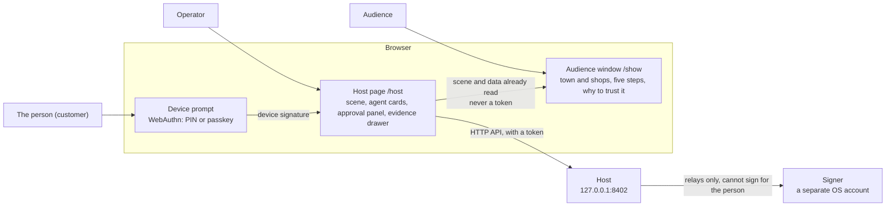
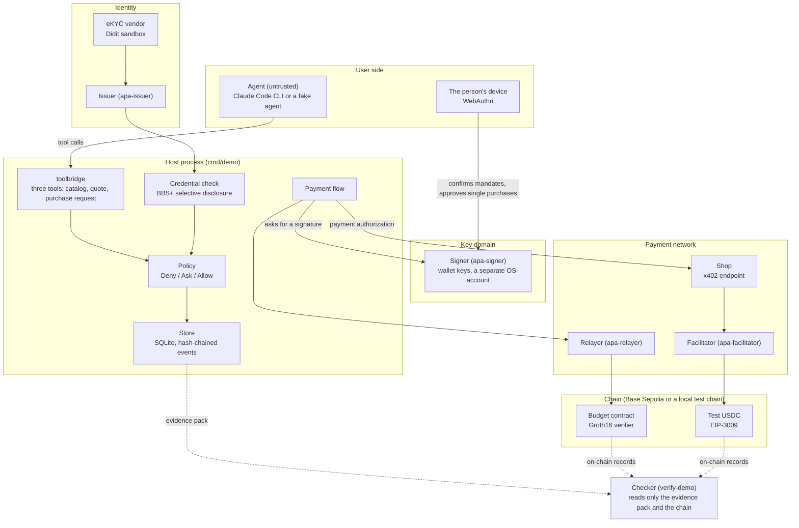
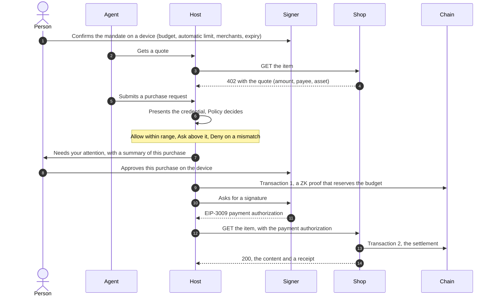
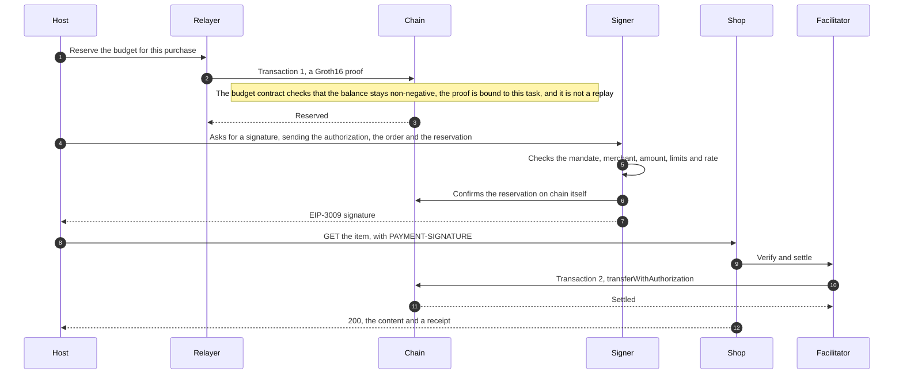

# agent-payment-authority

**English** | [繁體中文](README.zh-TW.md)

**An AI agent may propose a payment for a person. It may not approve it, and it may not sign it. Every step leaves evidence that anyone can check against the chain.**

This is a scenario simulation. A pixel-art town has a bookshop, a café, a convenience store, a hotel and a post office, and a family's AI agents shop there for them. The payments, the person's approvals and the evidence are real (testnet, test tokens). It is a demonstration, not a product.

- [What problem it solves](#what-problem-it-solves)
- [The screens you see](#the-screens-you-see)
- [The infrastructure behind them](#the-infrastructure-behind-them)
- [How one payment goes](#how-one-payment-goes)
- [How a payment gets signed](#how-a-payment-gets-signed)
- [Check it yourself](#check-it-yourself)
- [Status and limits](#status-and-limits)
- [Running it](#running-it)
- [Layout and documents](#layout-and-documents)
- [License](#license)

## What problem it solves

> If I let an AI spend my money, I worry about three things: **being tricked into spending, giving away my personal data, and not being able to say what happened afterwards.**

A wallet knows how much was spent. It does not know which task the money was for, or who agreed to it. This project supplies that part.

| | What it handles |
|---|---|
| **x402** | How to pay: the shop quotes a price with HTTP 402, the payer signs an authorization, a facilitator settles it on chain |
| **This layer** | Whether to pay: which task the money belongs to, under which mandate, by which rule, and with which approval from the person |

It splits power between roles that cannot reach into each other, and binds the task, the purchase request, the person's authorization, the budget, the payment and the delivery to one `intent_hash`.

## The screens you see

The demo runs in a browser on one computer. There are three screens, each for a different viewer.



| Screen | For | What is on it |
|---|---|---|
| **Host page** `/host` | Whoever runs the demo | The town and the shops (Unity); one agent card per customer, with start and stop; the approval panel; the evidence drawer; a presentation mode |
| **Audience window** `/show` | The audience | The same scene, with each customer's five steps (mandate, selection, approval, payment, delivery), a "why to trust it" list and the receipt. It holds no token and calls no API |
| **Device prompt** | The person | The browser's WebAuthn prompt. It appears when the person confirms a mandate or approves a purchase over the limit |

A few points of the design:

- **The audience window has no authority.** The host page keeps every token and does every read. It sends the audience window only scene messages and data it has already read, over a BroadcastChannel in the same browser. Putting the audience window on a big screen leaks no credential.
- **Every sentence on screen stands for a record.** The five steps come from the Store's events. With no event, a step is not shown as done; an unknown result is shown as unknown.
- **The agent sees none of these screens.** It works through three tools only: read the catalog, get a quote, submit a purchase request.
- **You can walk around the town.** In game mode a customer can walk into a shop, draw test USDC from an ATM on the street, or pass a subway gate that charges the fare automatically.

The five steps are the backbone of the interface. Each one says what the shop saw and who approved:

| Step | An example of what the screen says |
|---|---|
| 01 Mandate | The person confirmed the mandate on a registered device: budget 1.50 USDC, ask above 0.10 USDC |
| 02 Selection | The agent chose an item, quoted 0.50 USDC; this shop saw: country (identity verified by eKYC) |
| 03 Approval | Above the automatic range, waiting for the person |
| 04 Payment | Budget reserved (first transaction); settled (second transaction) |
| 05 Delivery | Delivered, with a receipt |

## The infrastructure behind them

Behind the screens are several separate processes. What matters is what each one holds, and what it cannot touch.



| Role | Holds | Can | Cannot |
|---|---|---|---|
| **Agent** | Nothing | Read the catalog, get a quote, submit a purchase request | Touch a key, change the amount or the payee, approve anything |
| **Host** | Tasks, rules, records | Build the purchase order, decide by Policy, record, send for payment | Sign (it has no key), forge the person's approval |
| **Signer** | The customers' wallet keys | Verify the person's device, sign a payment authorization within the mandate | Sign a payment outside the mandate |
| **The person** | A registered device | Confirm a mandate; approve a single purchase above the limit | — |
| **Issuer** | The credential signing key | Issue a credential from the eKYC result | Treat an approval it set by hand as a verification |
| **Relayer** | A transaction-sending key | Submit the ZK budget proof and reserve the budget | Move the customer's money |
| **Facilitator** | The shop's settlement key | Verify and submit the settlement; refund | Submit a transfer the customer did not sign |
| **Checker** | Nothing | Read the evidence pack and the chain, and judge ten claims on its own | Call any code of the Host, the Policy or the Signer |

Three kinds of data take three separate paths:

- **Money** moves only on chain, from the customer's wallet to the shop's wallet. It never passes through the agent or the Host.
- **Identity data** stops at the eKYC vendor. After that, what travels is a credential, and each shop gets only the attributes it asks for: the bookshop sees the country, the café sees nothing, the convenience store sees only whether the buyer is 18 or over.
- **Evidence** flows from the Store and the chain to the Checker. The Checker does not take the system's word; it recomputes against the chain.

## How one payment goes

Take a purchase above the automatic limit, which needs the person's approval.



There are three outcomes:

| Policy's decision | When | What follows |
|---|---|---|
| **Allow** | The amount is within the automatic range and every rule holds | Payment goes ahead without asking the person |
| **Ask** | The amount is above the automatic limit | The person approves this purchase on a device, then payment goes ahead |
| **Deny** | Over budget, merchant not on the list, credential mismatch, rate limit reached | It stops before payment; there is no transaction on chain |

The rules are deterministic. The model has no discretion. If the agent says "it has been paid", no record changes.

## How a payment gets signed

This is the part that matters most: the private key lives only in the Signer, and the Signer does not trust the Host.



**Before it signs, the Signer checks all of this itself** (it signs only if every check passes):

| Check | Why |
|---|---|
| The person confirmed this mandate on a device | Without the person's consent, the Host cannot create a mandate |
| The payee is on the mandate's merchant list | If the payee on a payment page is swapped, no signature comes out |
| The amount is within the per-payment limit and the mandate's total | A compromised Host still cannot spend outside the range |
| For a purchase above the automatic limit, there is the person's approval of this purchase, and it has not been used | An approval works once; it cannot be replayed |
| The wallet has not signed too many times within the time window | The rate limit exists once in the Host and once in the Signer |
| The budget for this purchase is already reserved on chain | It asks the chain, not the Host |

**What an EIP-3009 authorization states:**

| Field | Content |
|---|---|
| `from` | The customer's wallet |
| `to` | The shop's receiving address |
| `value` | The amount of this purchase |
| `validAfter`, `validBefore` | The validity window; it cannot be used after it expires |
| `nonce` | A one-time value; the same authorization cannot be used twice |

What gets signed is not a blank cheque. It is valid for this purchase, this payee, this amount and this time window only.

**How the person's approval is bound to it:**

1. The Signer issues a one-time challenge bound to a summary of this purchase.
2. The person's device signs it (WebAuthn). The Host only relays; it cannot sign for the person.
3. The Signer verifies the device signature and stores this approval.
4. When it signs the payment authorization, the Signer refers to this approval and consumes it.

So the line on screen that says "the person approved on a registered device" stands for one device signature the Signer verified. It is not the Host's claim.

**When something goes wrong:**

- **Unknown result** (a timeout, a restart, possibly already on chain): the Host reconciles against the chain first. If it settled, the Host fetches the content again with the same signature. It never pays twice.
- **Paid, but the shop did not deliver:** the chain shows it was paid, so it is recorded as a failed delivery waiting for a person. When the operator presses "shop refund", the shop sends a third transaction returning the full amount to the customer's wallet, and the Host records the refund only after confirming it on chain.

## Check it yourself

The Checker is a separate program. It reads only the evidence pack and the chain, and calls no code of the system.

**What you can run right now** (this repository only, no network):

```sh
go run ./cmd/verify-demo --run-dir testdata/verification/m1-fixture-20261009T162703Z-4ddb7a
```

It prints a JSON report with `"verdict": "PASS"`. This is an evidence bundle from an early stage: a fake agent and no payment. It demonstrates the practice of an evidence bundle checked by an independent program. It is not proof of the testnet payments.

**The testnet run** (Base Sepolia, 2026-10-31, a real Claude Code agent, two customers, the person confirming on a device) was checked like this:

```sh
go run ./cmd/verify-demo --mode e1a --run-dir artifacts/e1a/testnet-town-t4 --rpc https://sepolia.base.org
```

All ten claims, E1 to E10, passed. That run's evidence pack is not in this repository (`artifacts/` is not versioned), so you cannot run this command as it stands; ask the author for the pack. The Checker reads the scenario files of the commit the pack records, so it needs a full git clone, not a shallow one.

| | What the Checker confirms |
|---|---|
| E1 | The evidence files are complete and unchanged |
| E2 | Every step refers to the same purchase; each shop saw exactly the attributes it asked for |
| E3 | The event records link to each other in the right order |
| E4 | The two on-chain transactions and the ZK budget proof (checked against the chain) |
| E5 | No payment was repeated when a result was unknown |
| E6 | Every record says truthfully whether it was simulated or real |
| E7 | The two customers' identities and wallets were not mixed |
| E8 | No unauthorized payment happened in the period (recomputed from the chain) |
| E9 | The evidence holds only permitted fields, and a secret scan passes |
| E10 | Persuasive text on a shop's page did not push a payment past its authority |

## Status and limits

**Done**

- A real agent completed payment and delivery on Base Sepolia. The person confirmed mandates and approved single purchases on a device. The budget was reserved with a ZK proof. The Checker verified it against the chain.
- A family's town: a parent and a child under 18; a bookshop, a café and a convenience store. Each shop sees only the data it needs. The child's agent is stopped before payment when it tries to buy beer. An agent persuaded by a product page cannot spend beyond the budget.
- The hotel (the payee is swapped, stopped before payment), the post office (paid and not delivered, refunded by the shop), an ATM on the street, automatic fares at the subway gate, and a rate limit.
- The credential's identity source is connected to the sandbox of Didit, an eKYC vendor.
- Each customer's payment moves on its own: one waiting for its chain or its shop never holds up another's.

**Limits, stated plainly**

- It has run only on test chains with test tokens. There is no mainnet, no real money and no real shop.
- The hotel, the post office and the refund have run only on a local test chain, not yet on Base Sepolia.
- The eKYC connection is a sandbox: the flow is real, and no real person was verified.
- The issuer, the holder and the verifier run in one process. The two approvers are the same person on the same device.
- The policy is enforced off chain by the Policy and the Signer. Neither the contract nor the wallet enforces it.
- The ZK setup was generated by one party. The ZK budget is hidden from the chain only; the Relayer sees the cap and the balance.
- The relayer and the shop each have one key that sends transactions. Its nonces are handed out one at a time under a short lock (prepare, record, send), so heavy traffic would need more keys. One task's budget is spent one purchase at a time.
- Only the x402 `exact` scheme is implemented. The Facilitator and the Host are run by the same operator on the same computer.
- There is no dispute process and no escrow. If a shop refuses to refund, the system cannot force it.

The full threat model and limits: [docs/architecture.md](docs/architecture.md). How this divides the work with Coinbase CDP, AP2, ERC-8196, ERC-8366 and others: [docs/positioning.md](docs/positioning.md).

## Running it

You need Go 1.26 or later and make. Browser checks also need Node.js 20 or later and Google Chrome. The default fake mode and every test need no Claude Code CLI, model service, RPC or testnet account.

```sh
cp .env.example .env
make check          # go vet, tests, build; calls no model and no testnet
```

| To do this | Command | Notes |
|---|---|---|
| Run the tests | `make check` | Needs only this repository |
| A demo without payment | `make demo` | Fake agent, no payment; open `http://127.0.0.1:8402/host` |
| A demo paying on a local chain | `make demo-local` | Starts a local test chain, the Signer and the Host together; asks for the Signer's passphrase |
| A demo on the testnet | `make demo-testnet` | Base Sepolia; steps in [docs/host-manual.md](docs/host-manual.md) |
| Use eKYC as the identity source | `APA_PRESENT_EKYC_SESSION=<session> make demo-local` | See [docs/commercial-ekyc.md](docs/commercial-ekyc.md) |

Two things to know first:

- **The screens need Unity's Web build, which is not in Git.** The pixel art is licensed from LimeZu and cannot be distributed with the repository. Import assets you have licensed yourself, then build; the steps are in [docs/developer-guide.md](docs/developer-guide.md). Without the build, the API and the tests still work.
- **A real agent and testnet payments must be switched on explicitly.** By default no model is started and no transaction is sent.

Commands for each stage, settings, evidence bundles, the checker and the acceptance scripts: [docs/developer-guide.md](docs/developer-guide.md).

## Layout and documents

```text
cmd/
  demo/              Host: shops, Policy, Store, payment flow, web pages and API
  apa-signer/        Signer: wallet keys, device verification, signing authorizations
  apa-relayer/       Relayer: submits the ZK budget reservation
  apa-facilitator/   Facilitator: x402 v2 verify, settle and refund
  apa-issuer/        Issuer: credential directory, revocation, eKYC
  verify-demo/       Checker: read-only check of an evidence pack and the chain
  e1-evidence/       Packs one run into an evidence pack
  apa-buyer/ fake-claude/   the buyer host, and a fake agent that runs no model
internal/
  policy/ paypolicy/ deterministic Policy: Deny / Ask / Allow
  store/             SQLite, hash-chained events, recovery checks
  signer/            the Signer's checks, EIP-712 and EIP-3009 signing, WebAuthn
  credential/        BBS+ credentials, the status list, the eKYC record
  budget/            ZK budget: the proof and the budget contract
  merchant/ x402/ facilitator/   shops, x402 headers, settlement
  toolbridge/        the agent's three tools and purchase order assembly
  payflow/ reconcile/            payment steps and reconciliation
  verification/      the Checker's ten claims
web/                 host page, audience window, dashboard (plain HTML, CSS and JS)
unity/               the town and shop scenes (assets and builds are not in Git)
slides/              the payment architecture deck (open-slide)
scripts/             demo start-up, Unity builds, video, verification scripts
docs/                design documents
```

The design documents under `docs/` are written in Traditional Chinese.

| To learn about | Read |
|---|---|
| Architecture, threat model, limits | [docs/architecture.md](docs/architecture.md) |
| How it divides the work with other projects; what may and may not be claimed | [docs/positioning.md](docs/positioning.md) |
| Operating the demo | [docs/host-manual.md](docs/host-manual.md) |
| What data each shop sees | [docs/commercial-venues.md](docs/commercial-venues.md) |
| The payment flow and reconciliation | [docs/commercial-p2-host.md](docs/commercial-p2-host.md) |
| The Signer and the person's approval | [docs/commercial-p1b-design.md](docs/commercial-p1b-design.md), [docs/commercial-human-approval-design.md](docs/commercial-human-approval-design.md) |
| eKYC | [docs/commercial-ekyc.md](docs/commercial-ekyc.md) |
| Refunds, the rate limit | [docs/commercial-refund.md](docs/commercial-refund.md), [docs/commercial-velocity.md](docs/commercial-velocity.md) |
| The demo video's script | [docs/demo-video-script.md](docs/demo-video-script.md) |
| Earlier milestones | [docs/status-history.md](docs/status-history.md) |

**Not versioned:** `.env`, `bin/`, `var/` (runtime data and keys), `artifacts/` (evidence packs and videos), credential and key files, raw Claude Code CLI output, audio, and LimeZu's licensed assets. The rules are in `.gitignore`.

## License

Code and documents are under the [MIT License](LICENSE). These are outside it:

- **Pixel art:** the town and shop images are licensed assets from [LimeZu](https://limezu.itch.io). They are not in this repository and may not be distributed with it. The repository holds only a list of file names and an import script; to build the screens, obtain the assets yourself.
- **Font:** `unity/AgentPaymentAuthority/Assets/APA/Resources/NotoSansTC-APA.ttf` is a subset of Noto Sans TC under the SIL Open Font License 1.1. The license text is in the same folder as `NotoSansTC-OFL.txt`.
- **Third-party Go modules:** see [docs/third-party.md](docs/third-party.md) for each license.
- **The slide workspace:** `slides/` was scaffolded by [open-slide](https://github.com/open-slide/open-slide); its sample deck and skills come from that project.
