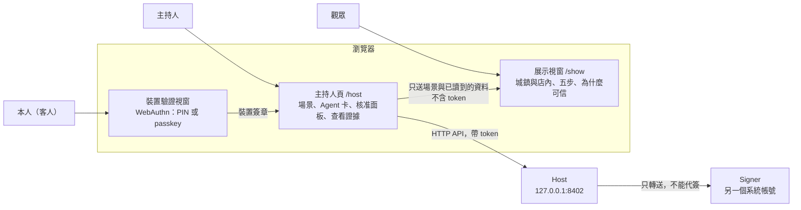
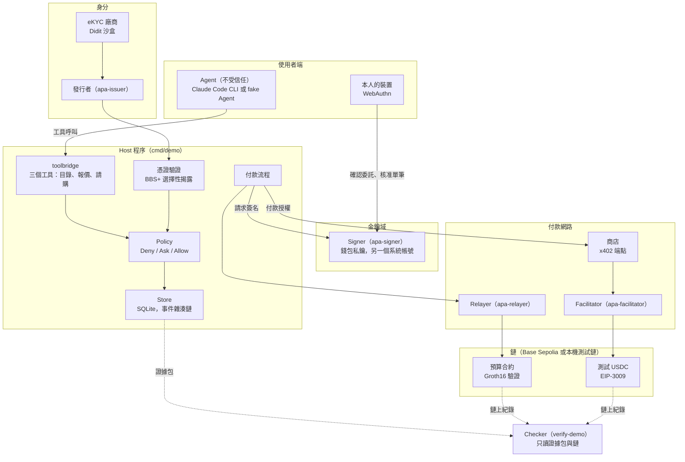
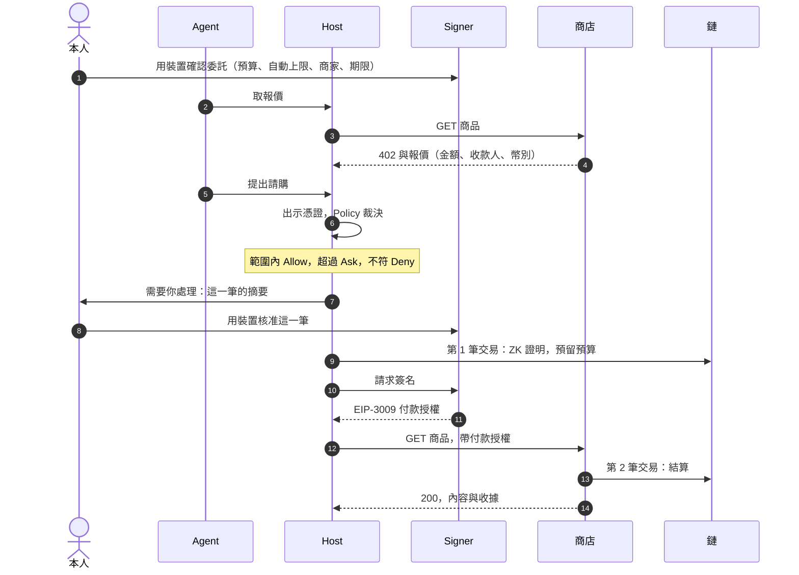
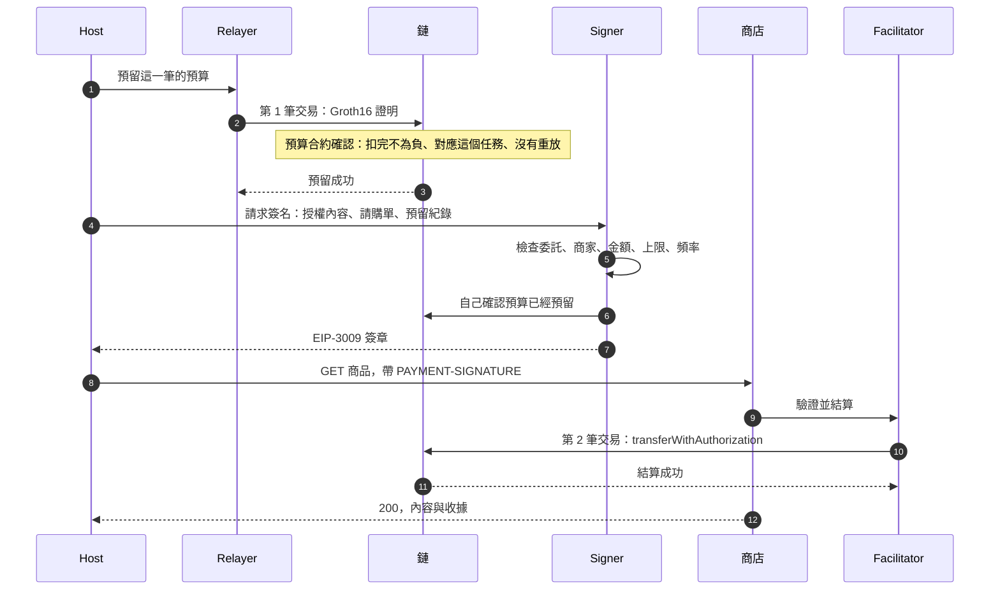

# agent-payment-authority

**AI Agent 可以替人提出付款，但不能自己批准，也不能自己簽名；每一步都留下任何人都能向鏈上查證的證據。**

*An authorization and evidence layer for AI agent payments on x402: the agent may propose a payment, never approve or sign it; every step leaves evidence anyone can verify against the chain.*

這是一個場域模擬：一座像素城鎮裡有書店、咖啡店、便利商店、飯店與郵局，一家人的 AI Agent 在裡面替他們買東西。付款、本人核准與證據都是真的（測試網與測試幣），但它是展示，不是產品。

- [它解決什麼問題](#它解決什麼問題)
- [你會看到的介面](#你會看到的介面)
- [背後的基礎設施](#背後的基礎設施)
- [一筆付款怎麼走](#一筆付款怎麼走)
- [交易是怎麼簽出來的](#交易是怎麼簽出來的)
- [自己查證](#自己查證)
- [現況與限制](#現況與限制)
- [跑起來](#跑起來)
- [目錄與文件](#目錄與文件)
- [授權](#授權)

## 它解決什麼問題

> 讓 AI 替我花錢，我最怕三件事：**被騙著亂花、個資被拿走、出了事說不清楚。**

錢包知道「花多少」，不知道「為了哪個任務、誰同意的」。這個專案補的是後者。

| | 負責什麼 |
|---|---|
| **x402** | 怎麼付：商店用 HTTP 402 報價，付款方簽一份授權，facilitator 上鏈結算 |
| **這一層** | 能不能付：這筆錢屬於哪個任務、依哪份委託、經過哪條規則與哪一次本人核准 |

做法是把權力拆給互不相通的角色，並把任務、請購、本人授權、預算、付款與交付綁在同一個 `intent_hash` 上。

## 你會看到的介面

展示在一台電腦的瀏覽器裡進行，有三個畫面，各給不同的人看。



| 畫面 | 給誰 | 上面有什麼 |
|---|---|---|
| **主持人頁** `/host` | 操作展示的人 | 像素城鎮與店內場景（Unity）；每位客人一張 Agent 卡，可以開始、停止；「需要你處理」的核准面板；「查看證據」抽屜；簡報模式 |
| **展示視窗** `/show` | 觀眾 | 同一個場景，加上每位客人的五步（委託、選購、核准、付款、交付）、「為什麼可信」與收據。它沒有 token，也不呼叫任何 API |
| **裝置驗證視窗** | 本人 | 瀏覽器的 WebAuthn 視窗。確認委託、核准超過上限的那一筆時跳出來 |

幾個設計上的重點：

- **展示視窗拿不到任何權限。** 主持人頁保有所有 token 與讀取；它只把場景訊息和已經讀到的資料送給展示視窗（同一個瀏覽器的 BroadcastChannel）。把展示視窗投到大螢幕，不會洩漏任何憑證。
- **畫面上的每一句話都對應一筆紀錄。** 五步的狀態來自 Store 的事件，沒有事件就不會顯示「完成」；結果不明就寫不明。
- **Agent 看不到這些畫面。** 它只能透過三個工具做事：看商品目錄、取報價、提出請購。
- **城鎮裡可以走動。** 遊戲模式下可以帶客人走進店裡、到街上的 ATM 領測試 USDC、走進地鐵閘門自動扣車資。

五步是整個介面的骨幹，每一步都說明這間店看到了什麼、誰核准的：

| 步 | 畫面上的例子 |
|---|---|
| 01 委託 | 本人以已登記的裝置確認了委託：預算 1.50 USDC，超過 0.10 USDC 要問本人 |
| 02 選購 | Agent 選好商品，報價 0.50 USDC；這間店看到：國家（身分經 eKYC 驗證） |
| 03 核准 | 超過自動範圍，等本人核准 |
| 04 付款 | 預留預算（第 1 筆鏈上交易）；結算（第 2 筆） |
| 05 交付 | 已交付，附收據 |

## 背後的基礎設施

畫面背後是幾個各自獨立的程序。重點是誰握有什麼，以及誰碰不到什麼。



| 角色 | 握有什麼 | 能做 | 不能做 |
|---|---|---|---|
| **Agent** | 什麼都沒有 | 看商品、取報價、提出請購 | 碰金鑰、改金額或收款人、自己核准 |
| **Host** | 任務、規則、紀錄 | 組請購單、依 Policy 裁決、記錄、送去付款 | 簽名（沒有私鑰）、偽造本人核准 |
| **Signer** | 客人錢包的私鑰 | 驗本人的裝置，在委託範圍內簽付款授權 | 簽委託外的付款 |
| **本人** | 已登記的裝置 | 確認委託；超過上限時核准單筆 | — |
| **發行者** | 憑證的簽發金鑰 | 依 eKYC 的結果簽發憑證 | 把自己改出來的「通過」當成驗證結果 |
| **Relayer** | 送交易的金鑰 | 送出 ZK 預算證明，預留預算 | 動客人的錢 |
| **Facilitator** | 商店的結算金鑰 | 驗證並送出結算；退款 | 送出沒有客人簽章的轉帳 |
| **Checker** | 什麼都沒有 | 只讀證據包與鏈，獨立判定十項主張 | 呼叫 Host、Policy 或 Signer 的程式 |

三條資料各走各的路：

- **錢**只在鏈上移動：從客人的錢包到商店的錢包。它不經過 Agent，也不經過 Host。
- **身分資料**只到 eKYC 廠商。之後傳的是憑證，每間店只拿到它要求的屬性：書店只看國家，咖啡店什麼都不看，便利商店只看是否滿 18 歲。
- **證據**從 Store 與鏈流向 Checker。Checker 不相信系統自己的說法，向鏈重算。

## 一筆付款怎麼走

以一筆超過自動上限、需要本人核准的請購為例。



結果有三種：

| Policy 的裁決 | 什麼時候 | 接下來 |
|---|---|---|
| **Allow** | 金額在自動範圍內，規則都符合 | 不問本人，直接走付款 |
| **Ask** | 超過自動上限 | 本人用裝置核准這一筆，才走付款 |
| **Deny** | 超出預算、商家不在名單、憑證不符、頻率超限 | 付款前就停下，沒有任何鏈上交易 |

規則是確定性的，模型沒有裁量空間。Agent 說「已經付款了」也不會改變任何紀錄。

## 交易是怎麼簽出來的

這是整個系統最關鍵的一段：私鑰只在 Signer，而 Signer 不相信 Host。



**Signer 簽之前，自己檢查這些事**（全部通過才簽）：

| 檢查 | 目的 |
|---|---|
| 本人用裝置確認過這份委託 | 沒有本人同意，Host 開不出委託 |
| 收款人在委託的商家名單裡 | 付款頁的收款人被換掉時，簽不出來 |
| 金額不超過每筆上限與委託總額 | Host 被入侵也花不出範圍外的錢 |
| 超過自動上限的那一筆，有本人對這一筆的核准，而且沒用過 | 核准只能用一次，不能重放 |
| 同一個錢包在時間窗內的簽名次數沒有超限 | 頻率上限在 Host 與 Signer 各有一道 |
| 鏈上已經為這一筆預留預算 | 自己向鏈查，不聽 Host 說 |

**一份 EIP-3009 授權寫明了什麼**：

| 欄位 | 內容 |
|---|---|
| `from` | 客人的錢包 |
| `to` | 商店的收款地址 |
| `value` | 這一筆的金額 |
| `validAfter`、`validBefore` | 有效期限；過期就不能用 |
| `nonce` | 一次性值；同一份授權不能用第二次 |

簽出來的不是空白支票，只對這一筆、這個收款人、這個金額、這段時間有效。

**本人核准是怎麼綁上去的**：

1. Signer 發一個一次性的 challenge，內容綁定這一筆請購的摘要。
2. 本人的裝置對它簽章（WebAuthn）。Host 只負責轉送，沒辦法替本人簽。
3. Signer 驗證裝置簽章，保存這一次核准。
4. 簽付款授權時，Signer 引用並消耗這一次核准。

所以畫面上那句「本人以已登記的裝置核准」，對應的是 Signer 驗過的一次裝置簽章，不是 Host 的說法。

**出事的時候**：

- **結果不明**（逾時、重啟、可能已上鏈）：先向鏈對帳，確認已結算就用同一份簽章重取內容；絕不重付。
- **付了款，商店沒交付**：由鏈判斷已付款，記為交付失敗、待人工處理。主持人按下「商店退款」後，商店送出第 3 筆交易把全額退回客人的錢包，Host 向鏈確認後才記退款。

## 自己查證

Checker 是一支獨立的程式：只讀證據包與鏈，不呼叫系統裡的任何程式。

**現在就能跑的**（只需要這個 repo，不連網）：

```sh
go run ./cmd/verify-demo --run-dir testdata/verification/m1-fixture-20261009T162703Z-4ddb7a
```

會印出一份 JSON 報告，`"verdict": "PASS"`。這是早期階段的一份證據包：fake Agent、沒有付款。它示範的是「證據包加上獨立檢查器」這個做法，不是測試網付款的證明。

**測試網的那一場**（Base Sepolia，2026-10-31，真實 Claude Code Agent、兩位客人、本人裝置確認）是這樣查的：

```sh
go run ./cmd/verify-demo --mode e1a --run-dir artifacts/e1a/testnet-town-t4 --rpc https://sepolia.base.org
```

結果是十項主張 E1～E10 全部 PASS。這一場的證據包不在 repo 裡（`artifacts/` 不進版控），所以這行指令你現在跑不了；要證據包的話向作者索取。Checker 會讀證據包記錄的那個 commit 的情境檔，所以要用完整的 git clone，不能用淺層 clone。

| | Checker 確認什麼 |
|---|---|
| E1 | 證據檔案完整、沒有被改動 |
| E2 | 每一步都對到同一筆請購；每間店看到的正好是它要求的屬性 |
| E3 | 事件紀錄前後相連、順序正確 |
| E4 | 兩筆鏈上交易與 ZK 預算證明（向鏈查證） |
| E5 | 結果未知時沒有重複付款 |
| E6 | 每筆紀錄如實標示是模擬還是真實 |
| E7 | 兩位客人的身分與錢包互不混用 |
| E8 | 期間沒有未經授權的付款（向鏈重算） |
| E9 | 證據只含允許的欄位，祕密掃描通過 |
| E10 | 商店頁面裡的誘導文字沒有讓付款越權 |

## 現況與限制

**做到的**

- 真實 Agent 在 Base Sepolia 上完成付款與交付；本人以裝置確認委託、核准單筆；ZK 預算預留；Checker 向鏈查證通過。
- 一家人的城鎮：家長與未滿 18 歲的孩子，書店、咖啡店、便利商店。每間店只看到它要的資料；孩子的 AI 買酒在付款前被擋下；被商品頁誘導的 Agent 花不到預算外的錢。
- 飯店（收款人被換掉，付款前擋下）、郵局（付了款沒交付，商店退款）、街上的 ATM、地鐵閘門的自動扣款、頻率上限。
- 憑證的身分來源接上 eKYC 廠商 Didit 的沙盒。

**照實說的限制**

- 只在測試鏈與測試幣上跑過，沒有 mainnet、真實資金或真實商店。
- 飯店、郵局與退款目前只在本機測試鏈跑過，還沒上 Base Sepolia。
- eKYC 接的是沙盒：流程是真的，沒有驗證真人。
- 發行者、持有人與驗證者在同一個程序裡；兩位核准人是同一個人、同一台裝置。
- 政策在鏈下由 Policy 與 Signer 執行，合約與錢包層不強制。
- ZK 的 setup 是單方產生的；ZK 預算只對鏈上隱藏，Relayer 看得到上限與餘額。
- x402 只做了 `exact`；Facilitator 與 Host 由同一位主持人在同一台電腦上跑。
- 沒有爭議流程與託管：商店不肯退款時，系統沒有辦法強制。

完整的威脅模型與限制：[docs/architecture.md](docs/architecture.md)。跟 Coinbase CDP、AP2、ERC-8196、ERC-8366 等的分工：[docs/positioning.md](docs/positioning.md)。

## 跑起來

需要 Go 1.26 以上與 make；瀏覽器檢查另需 Node.js 20 以上與 Google Chrome。預設的 fake 模式與所有測試不需要 Claude Code CLI、模型服務、RPC 或測試網帳戶。

```sh
cp .env.example .env
make check          # go vet、測試、建置；不呼叫模型、不連測試網
```

| 想做什麼 | 指令 | 說明 |
|---|---|---|
| 只跑測試 | `make check` | 只需要這個 repo |
| 不付款的展示 | `make demo` | fake Agent，沒有付款；開 `http://127.0.0.1:8402/host` |
| 本機付款的展示 | `make demo-local` | 本機測試鏈、Signer、Host 一次啟動；會問 Signer 的密語 |
| 測試網的展示 | `make demo-testnet` | Base Sepolia；步驟見 [docs/host-manual.md](docs/host-manual.md) |
| 用 eKYC 的身分來源 | `APA_PRESENT_EKYC_SESSION=<session> make demo-local` | 見 [docs/commercial-ekyc.md](docs/commercial-ekyc.md) |

兩件事要先知道：

- **畫面需要 Unity 的 Web 建置，它不在 Git 裡。** 像素美術是 LimeZu 的授權素材，不能隨 repo 散布。要先匯入本機已取得授權的素材再建置，步驟見 [docs/developer-guide.md](docs/developer-guide.md)。沒有建置時，API 與測試照常可用。
- **真實 Agent 與測試網付款都要明確開啟。** 預設不會啟動模型，也不會送出任何交易。

各階段的啟動方式、設定、證據包與檢查器、驗收腳本：[docs/developer-guide.md](docs/developer-guide.md)。

## 目錄與文件

```text
cmd/
  demo/              Host：商店、Policy、Store、付款流程、網頁與 API
  apa-signer/        Signer：錢包私鑰、裝置驗證、簽付款授權
  apa-relayer/       Relayer：送出 ZK 預算預留
  apa-facilitator/   Facilitator：x402 v2 的驗證、結算與退款
  apa-issuer/        發行者：憑證目錄、撤銷、eKYC
  verify-demo/       Checker：唯讀檢查證據包與鏈
  e1-evidence/       把一場實跑打包成證據包
  apa-buyer/ fake-claude/   buyer host 與不跑模型的 fake Agent
internal/
  policy/ paypolicy/ 確定性 Policy：Deny / Ask / Allow
  store/             SQLite、事件雜湊鏈、恢復驗證
  signer/            Signer 的檢查、EIP-712 與 EIP-3009 簽章、WebAuthn
  credential/        BBS+ 憑證、狀態清單、eKYC 紀錄
  budget/            ZK 預算：證明與預算合約
  merchant/ x402/ facilitator/   商店、x402 header、結算
  toolbridge/        Agent 的三個工具與請購組裝
  payflow/ reconcile/            付款步驟與對帳
  verification/      Checker 的十項主張
web/                 主持人頁、展示視窗、Dashboard（原生 HTML／CSS／JS）
unity/               像素城鎮與店內場景（素材與建置不進 Git）
slides/              付款架構簡報（open-slide）
scripts/             展示啟動、Unity 建置、影片、驗證腳本
docs/                設計文件
```

| 想了解 | 看這份 |
|---|---|
| 架構、威脅模型、限制 | [docs/architecture.md](docs/architecture.md) |
| 跟其他方案的分工，能說與不能說 | [docs/positioning.md](docs/positioning.md) |
| 現場怎麼操作 | [docs/host-manual.md](docs/host-manual.md) |
| 每間店看到什麼資料 | [docs/commercial-venues.md](docs/commercial-venues.md) |
| 付款流程與對帳 | [docs/commercial-p2-host.md](docs/commercial-p2-host.md) |
| Signer 與本人核准 | [docs/commercial-p1b-design.md](docs/commercial-p1b-design.md)、[docs/commercial-human-approval-design.md](docs/commercial-human-approval-design.md) |
| eKYC | [docs/commercial-ekyc.md](docs/commercial-ekyc.md) |
| 退款、頻率上限 | [docs/commercial-refund.md](docs/commercial-refund.md)、[docs/commercial-velocity.md](docs/commercial-velocity.md) |
| 展示影片的腳本 | [docs/demo-video-script.md](docs/demo-video-script.md) |
| 過去的里程碑紀錄 | [docs/status-history.md](docs/status-history.md) |

**不進版控的東西**：`.env`、`bin/`、`var/`（執行資料與金鑰）、`artifacts/`（證據包與影片）、憑證與金鑰檔、Claude Code CLI 的原始輸出、音檔、LimeZu 授權素材。規則在 `.gitignore`。

## 授權

程式碼與文件以 [MIT License](LICENSE) 授權。下面這些不在 MIT 的範圍內：

- **像素美術**：城鎮與店內的圖是 [LimeZu](https://limezu.itch.io) 的授權素材，不在這個 repo 裡，也不能隨它散布。repo 只有檔名清單與匯入腳本；要建置畫面，請自行取得素材。
- **字型**：`unity/AgentPaymentAuthority/Assets/APA/Resources/NotoSansTC-APA.ttf` 是 Noto Sans TC 的子集，依 SIL Open Font License 1.1 授權，授權全文在同一個資料夾的 `NotoSansTC-OFL.txt`。
- **第三方 Go 模組**：各自的授權見 [docs/third-party.md](docs/third-party.md)。
- **簡報工作區**：`slides/` 由 [open-slide](https://github.com/open-slide/open-slide) 產生，其中的範例簡報與 skills 來自該專案。
