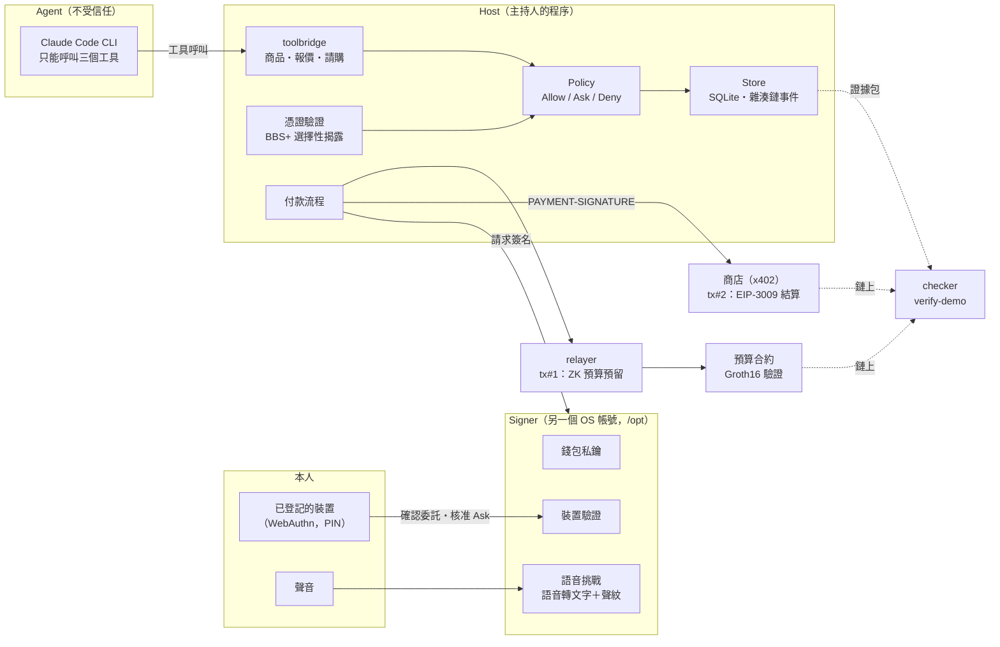

# 架構與威脅模型（一頁）

> 給第一次看這個專案的人。細節在各份設計文件；這一頁只講：誰握有什麼權力、一筆付款怎麼走、擋得住什麼、擋不住什麼。

## 一句話

**AI Agent 可以替人提出付款，但不能自己批准，也不能自己簽名；每一步都留下任何人都能向鏈上查證的證據。**

錢包知道「花多少」，不知道「為了哪個任務、哪一步」。這個專案把任務、請購、本人授權、預算、付款與交付綁成同一個 `intent_hash`，再把權力拆給互不相通的角色。

## 角色與權力

| 角色 | 能做 | 不能做 |
|---|---|---|
| Agent | 看商品、取報價、提出請購 | 碰金鑰、改金額或收款人、自己核准 |
| Host | 組請購單、依 Policy 裁決、記錄、送去付款 | 簽名（沒有錢包私鑰）、偽造本人核准 |
| Signer | 驗本人的裝置與聲音、在委託範圍內簽 EIP-3009 授權 | 簽委託外的付款、在沒有本人確認的委託下簽 |
| 本人 | 用裝置確認委託（預算、自動範圍）；大額時用裝置加語音核准單筆 | — |
| checker | 只讀證據包與鏈，獨立判定 E1～E10 | 不呼叫 Host、Store、Policy 或 Signer 的程式 |

## 一筆付款怎麼走

1. **委託**：本人用已登記的裝置確認委託條款（任務預算、自動放行上限、商家、期限）。Signer 記下這份確認；之後每一筆付款都要帶它（gap4）。
2. **選購**：Agent 呼叫工具取報價、提出請購。Host 依可信的報價組出請購單，算出 `intent_hash`。客人的 **BBS+ 憑證**只揭露這間店要求的屬性：複合式書店只看國家（數位內容的地區授權），咖啡店什麼都不看，便利商店只看是否已滿 18 歲（`docs/commercial-venues.md`）。
3. **核准**：確定性 Policy 裁決。在自動範圍內就 Allow；超過就 Ask：本人在裝置上看見同一筆請購的摘要，唸出綁定商家、金額與一次性值的句子，Signer 驗證裝置簽章、文字與聲紋後才核准。憑證不符這間店的要求就 Deny。
4. **付款**：兩筆鏈上交易（Base Sepolia）。
   - tx#1：relayer 送出 **Groth16 證明**，預算合約驗證「扣完不為負、對應這個 task、nullifier 沒用過」，再預留預算。
   - tx#2：Signer 簽 EIP-3009 授權，商店驗證後結算 test USDC。
5. **交付**：商店交付內容並開收據，收據記下內容的 sha256。

事件存在 Store，形成每個 task 一條雜湊鏈；場次結束後打包成證據包，由 checker 對鏈查證。

## 可以獨立查證的事（E1～E10）

| | checker 確認什麼 |
|---|---|
| E1 | 證據檔案完整、沒有被改動 |
| E2 | 每一步都對到同一筆請購；每間店看到的正好是它要求的屬性 |
| E3 | 事件紀錄前後相連、順序正確 |
| E4 | 兩筆鏈上交易與 ZK 預算證明（向鏈查證） |
| E5 | 結果未知時沒有重複付款 |
| E6 | 每筆紀錄如實標示是模擬還是真實 |
| E7 | 兩位客人的身分與錢包互不混用 |
| E8 | 期間沒有未經授權的付款（向鏈重算） |
| E9 | 證據只含允許的欄位，祕密掃描通過 |
| E10 | 商店頁面裡的誘導文字沒有讓付款越權 |

Base Sepolia 上的實跑（10/31，`artifacts/e1a/testnet-town-t4`）E1～E10 全部 PASS。

## 威脅模型

| 威脅 | 擋法 | 還剩下的風險 |
|---|---|---|
| Agent 被提示注入，想多買或付給別人 | Agent 只能提出請購；金額、收款人來自可信報價；Policy 確定性裁決；超過自動範圍要本人核准；Signer 只簽委託內的商家與金額 | 在自動範圍內（每筆 ≤ 0.10）買了不該買的東西，仍會成交；靠上限與任務預算限制損失 |
| Host 被入侵 | Host 沒有私鑰；Signer 自己驗本人的裝置與聲音，並檢查委託確認、每筆上限、總額與核准人 24 小時上限 | Host 可以拒絕服務或延遲，也可以把錯的摘要拿給本人看；本人在裝置上確認的是 Signer 綁定的內容 |
| 重放舊的核准或付款 | 每次核准都是一次性 challenge；EIP-3009 nonce；ZK nullifier；Store 以 request ID 去重 | — |
| 錄音冒充本人 | 每次唸的句子含一次性值；聲紋比對；還要裝置簽章 | **沒有做抗合成語音**（V1 的決定）；聲紋只是一個訊號，裝置才是主要的持有證明 |
| 商店要求過多個資 | 每項商品宣告要求的屬性；BBS+ 只揭露那些；checker E2 驗「不多不少」 | 要求表現在由 Host 設定，不是商店宣告後由 Policy 設上限 |
| 憑證被撤銷或過期 | 每次驗證、核准與付款前都重新讀簽章的狀態清單 | 狀態清單的防回捲只對 Store 看過的版本有效 |
| 有人事後竄改紀錄 | 事件雜湊鏈；證據包 manifest；checker 向鏈重算 | — |

## 照實說的限制

- issuer、holder、verifier 在同一個程序裡：證明的是格式、綁定與撤銷的接線，不是三方互相獨立。
- 兩位核准人其實是同一個人、同一台裝置；身分是固定的測試資料。
- `age_over_18` 是 issuer 簽好的布林值，不是範圍證明（憑證裡沒有生日）。
- 付款依序處理，不是同時付款。
- 只在 Base Sepolia 測試鏈與 test USDC 上跑過，沒有 mainnet、法幣或真實商店。
- 預算的 ZK setup 是單方產生的，信任它等同信任主持人。
- ZK 預算只對鏈上隱藏：鏈上只看得到承諾值；relayer 在自己的資料庫裡保存每個任務的預算餘額與隨機數，看得到上限與剩餘。
- x402 只做了 `exact`（沒有 `upto`、`batch`）。商店在同一個程序裡自己驗證並結算（P2-D3 選 A），沒有獨立的 facilitator 服務，也沒有分開的 `/verify` 與 `/settle`；從來沒有經過外部 facilitator（x402.org、CDP）結算，test402.com 那一筆只驗證 wire 相容（test402 不結算）。對外只說「採用 x402 v2 的 HTTP 支付協商」，不說「符合 x402」（`docs/positioning.md` §5）。
- 付款金鑰只有一層：客人的錢包私鑰在 Signer，加上有總額與期限的委派；沒有金庫、資金錢包、session key 的分層（relayer 另有送交易、登記任務、授權預留三把測試金鑰，商店有自己的結算金鑰）。
- 政策在鏈下由 Signer 執行：它先到鏈上確認預算已預留才簽，但 test USDC 合約本身不認預留；沒有錢包層的強制執行（ERC-8196、ERC-7710，見 `docs/adr/payment-account-model.md`）。
- Policy 沒有頻率限制（每分鐘幾筆）：自動範圍內的小額連續付款，只靠每筆上限與任務預算擋。
- 商家是固定名單，沒有身分與信譽（ERC-8004）；沒有爭議與退款流程；沒有交易監控（KYT）。
