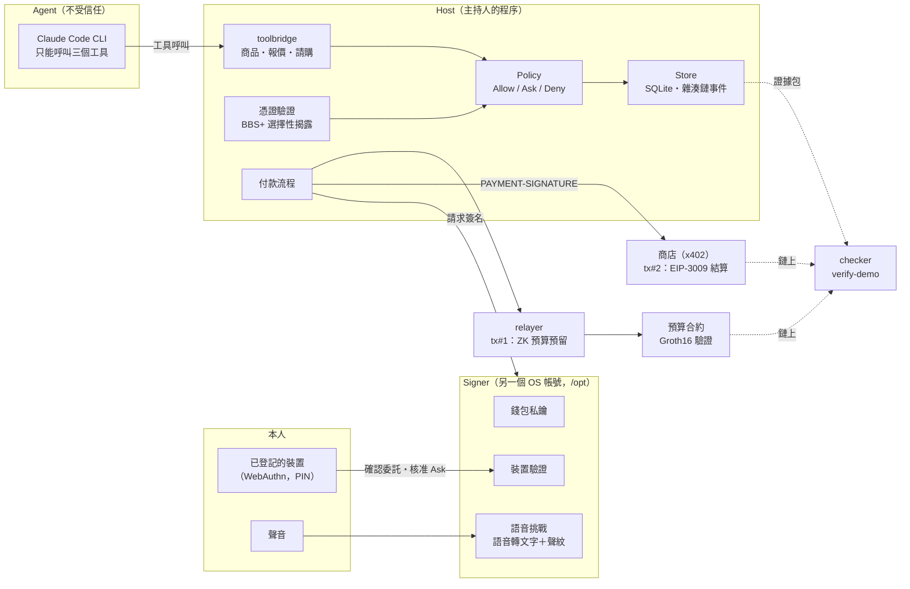

# 架構與威脅模型（一頁）

> 給第一次看這個專案的人。細節在各份設計文件；這一頁只講：誰握有什麼權力、一筆付款怎麼走、擋得住什麼、擋不住什麼。

## 一句話

**AI Agent 可以替人提出付款，但不能自己批准，也不能自己簽名；每一步都留下任何人都能向鏈上查證的證據。**

錢包知道「花多少」，不知道「為了哪個任務、哪一步」。這個專案把任務、請購、本人授權、預算、付款與交付綁成同一個 `intent_hash`，再把權力拆給互不相通的角色。

## 角色與權力

| 角色 | 能做 | 不能做 |
|---|---|---|
| Agent | 看商品、取報價、提出請購 | 碰金鑰、改金額或收款人、自己核准 |
| Host | 組請購單、依 Policy 裁決、記錄、送去付款 | 簽名（沒有錢包私鑰）、偽造本人核准 |
| Signer | 驗本人的裝置與聲音、在委託範圍內簽 EIP-3009 授權 | 簽委託外的付款、在沒有本人確認的委託下簽 |
| 本人 | 用裝置確認委託（預算、自動範圍）；大額時用裝置加語音核准單筆 | — |
| checker | 只讀證據包與鏈，獨立判定 E1～E10 | 不呼叫 Host、Store、Policy 或 Signer 的程式 |

## 一筆付款怎麼走

1. **委託**：本人用已登記的裝置確認委託條款（任務預算、自動放行上限、商家、期限）。Signer 記下這份確認；之後每一筆付款都要帶它（gap4）。
2. **選購**：Agent 呼叫工具取報價、提出請購。Host 依可信的報價組出請購單，算出 `intent_hash`。客人的 **BBS+ 憑證**只揭露這間店要求的屬性：複合式書店只看國家（數位內容的地區授權），咖啡店什麼都不看，便利商店只看是否已滿 18 歲（`docs/commercial-venues.md`）。
3. **核准**：確定性 Policy 裁決。在自動範圍內就 Allow；超過就 Ask：本人在裝置上看見同一筆請購的摘要，唸出綁定商家、金額與一次性值的句子，Signer 驗證裝置簽章、文字與聲紋後才核准。憑證不符這間店的要求就 Deny。
4. **付款**：兩筆鏈上交易（Base Sepolia）。
   - tx#1：relayer 送出 **Groth16 證明**，預算合約驗證「扣完不為負、對應這個 task、nullifier 沒用過」，再預留預算。
   - tx#2：Signer 簽 EIP-3009 授權，商店驗證後結算 test USDC。
5. **交付**：商店交付內容並開收據，收據記下內容的 sha256。商店結算了卻沒交付時，由鏈判斷：鏈上已付款就記 `DELIVERY_FAILED`、待人工處理，不會再付一次（郵局示範這種情況，`docs/commercial-post-hotel.md`）。

事件存在 Store，形成每個 task 一條雜湊鏈；場次結束後打包成證據包，由 checker 對鏈查證。

## 可以獨立查證的事（E1～E10）

| | checker 確認什麼 |
|---|---|
| E1 | 證據檔案完整、沒有被改動 |
| E2 | 每一步都對到同一筆請購；每間店看到的正好是它要求的屬性 |
| E3 | 事件紀錄前後相連、順序正確 |
| E4 | 兩筆鏈上交易與 ZK 預算證明（向鏈查證） |
| E5 | 結果未知時沒有重複付款 |
| E6 | 每筆紀錄如實標示是模擬還是真實 |
| E7 | 兩位客人的身分與錢包互不混用 |
| E8 | 期間沒有未經授權的付款（向鏈重算） |
| E9 | 證據只含允許的欄位，祕密掃描通過 |
| E10 | 商店頁面裡的誘導文字沒有讓付款越權 |

Base Sepolia 上的實跑（10/31，`artifacts/e1a/testnet-town-t4`）E1～E10 全部 PASS。

### checker 查不到的事（11/18）

鏈證明的是結算，不是意圖。E1～E10 回答的是：證據有沒有被改、付款有沒有超出授權、和鏈上的結果對不對得上。下面這些不在範圍內：

| 查不到 | 為什麼 | 這裡怎麼處理 |
|---|---|---|
| Agent 有沒有理解本人要什麼 | 鏈上只有簽章、nonce 與轉帳 | 超過自動範圍的每一筆，都要本人在裝置上核准；範圍內的，靠每筆上限與任務預算限制損失 |
| 這筆買得合不合理 | 這是判斷，不是密碼學能驗的事 | 同上。E10 只確認誘導文字沒有讓付款越權，不確認買的東西有沒有用 |
| 商家可不可信、交付的內容對不對 | 鏈看不到交付；收據只記下內容的 sha256 | 商家是固定名單；付了款沒交付，由人判斷要不要退 |
| 本人是不是真的本人 | 身分來自 eKYC 沙盒與測試資料 | 見下方「照實說的限制」 |

## 威脅模型

| 威脅 | 擋法 | 還剩下的風險 |
|---|---|---|
| Agent 被提示注入，想多買或付給別人 | Agent 只能提出請購；金額、收款人來自可信報價；Policy 確定性裁決；超過自動範圍要本人核准；Signer 只簽委託內的商家與金額 | 在自動範圍內（每筆 ≤ 0.10）買了不該買的東西，仍會成交；靠上限與任務預算限制損失 |
| 付款頁的收款人被換掉（像假的訂房網站；飯店示範） | 收款人不在 Policy 的商店名單就 Deny `MERCHANT_NOT_ALLOWED`，付款前就擋下，錢沒有動；Signer 的委託也沒有這個收款人 | 名單上的商家自己作假或被入侵，仍然收得到錢；名單由主持人設定，沒有商家身分與信譽 |
| 付了款，商店沒交付（郵局示範） | 由鏈判斷，不信商店的說法：鏈上已付款就記 `DELIVERY_FAILED`、待人工處理，不再付一次；付了多少、付給誰都在紀錄裡。主持人按「商店退款」，商店把全額退回付款錢包，Host 自己向鏈上確認後才記 `PAYMENT_REFUNDED`，checker 也查（`docs/commercial-refund.md`） | 該不該退由人判斷；商店不肯退，系統沒有辦法強制（沒有託管）；沒有爭議流程與部分退款 |
| Host 被入侵 | Host 沒有私鑰；Signer 自己驗本人的裝置與聲音，並檢查委託確認、每筆上限、總額與核准人 24 小時上限 | Host 可以拒絕服務或延遲，也可以把錯的摘要拿給本人看；本人在裝置上確認的是 Signer 綁定的內容 |
| 重放舊的核准或付款 | 每次核准都是一次性 challenge；EIP-3009 nonce；ZK nullifier；Store 以 request ID 去重 | — |
| 錄音冒充本人 | 每次唸的句子含一次性值；聲紋比對；還要裝置簽章 | **沒有做抗合成語音**（V1 的決定）；聲紋只是一個訊號，裝置才是主要的持有證明 |
| 商店要求過多個資 | 每項商品宣告要求的屬性；BBS+ 只揭露那些；checker E2 驗「不多不少」 | 要求表現在由 Host 設定，不是商店宣告後由 Policy 設上限 |
| 憑證被撤銷或過期 | 每次驗證、核准與付款前都重新讀簽章的狀態清單 | 狀態清單的防回捲只對 Store 看過的版本有效 |
| 有人事後竄改紀錄 | 事件雜湊鏈；證據包 manifest；checker 向鏈重算 | — |

## OWASP Agentic Top 10 對照（11/18）

OWASP GenAI Security Project 在 2025-12-09 發布 Top 10 for Agentic Applications（2026 年版）。FUTUREMODE 的講者挑了其中六項來談 Agent 支付的威脅；這裡十項全列，並照實標出做到哪裡。

| 風險 | 落在付款上會怎樣 | 這裡的控制 | 查證或測試 | 狀態 |
|---|---|---|---|---|
| ASI01 Agent Goal Hijack | 替攻擊者指定的東西付錢 | Agent 只能提出請購；金額與收款人來自可信的報價；超過自動範圍要本人核准；超出任務預算 Policy 就拒絕（書店的「系統通知」那一幕） | E10；`internal/ae1` 的評測；`internal/policy` 的 `INSUFFICIENT_BUDGET` 測試 | 越權的付款會被擋下；自動範圍內（每筆 ≤ 0.10）仍可能買錯 |
| ASI02 Tool Misuse and Exploitation | 付款工具被拿去做範圍外的事 | Agent 只有三個工具：看商品、取報價、提出請購，沒有付款工具。收款人不在名單上就 Deny `MERCHANT_NOT_ALLOWED`（飯店那一幕） | `internal/buyer/host.go` 的 CLI 參數；`internal/policy` 與 `internal/signer` 的 `MERCHANT_NOT_ALLOWED` 測試 | 做到 |
| ASI03 Identity and Privilege Abuse | 被入侵的 Agent 超支 | Agent 沒有私鑰。Signer 在另一個 OS 帳號，只在本人確認過的委託內簽名（總額、期限、每筆上限）。Agent 的鏈上身分（ERC-8004）綁定付款錢包 | E7、E8；`TestTotalCap`、`TestConcurrentCap` | 做到；身分由展示平台代為註冊 |
| ASI04 Agentic Supply Chain Vulnerabilities | 工具或模型被換掉，付款行為跟著變 | 實跑時，CLI 回報的版本不是核准的版本（`buyer.ApprovedCLIVersion`）就中止（`internal/buyer/gate.go`）；只連自己的工具伺服器（`--strict-mcp-config`）；不讀使用者與專案設定（`--restricted`） | 實跑前的檢查 | 部分做到：沒有 SBOM，也沒有驗套件簽章 |
| ASI05 Unexpected Code Execution | Agent 執行程式碼去動錢 | Agent 沒有任何內建工具（`--tools ""`）；凡是需要詢問權限的動作一律拒絕 | `internal/buyer/host.go` | 做到；就算執行了程式碼，也碰不到私鑰 |
| ASI06 Memory and Context Poisoning | 被污染的上下文改變之後的付款 | Policy 與 Signer 不讀 Agent 的推理，只讀 Host 依可信報價組出的請購單；每次執行都不保留對話（`--no-session-persistence`） | — | 部分做到：Agent 沒有長期記憶，所以也沒有記憶驗證 |
| ASI07 Insecure Inter-Agent Communication | Agent 之間互傳假指令 | 兩位 Agent 互不通訊，各自只對 Host 提出請購 | E7 | 不適用：沒有 Agent 對 Agent 的付款 |
| ASI08 Cascading Failures | 重試造成重複扣款 | 結果未知不等於可以再付一次；EIP-3009 nonce、ZK nullifier、Store 以 request ID 去重；頻率上限 | E5；`TestSlowSettlementIsNotRepaid`、`TestSettleOncePerAuthorization`、`TestUnknownThenResume` | 做到 |
| ASI09 Human-Agent Trust Exploitation | 誤導的摘要騙本人按下核准 | 本人在裝置上看到的是 Signer 綁定的結構化摘要，不是模型的說法；要唸出含一次性值的句子；請購在核准前被改，核准就失效 | `TestHumanApprovalChangesBeforeAccept`；`internal/signer/voice_test.go` | 做到；沒有做抗合成語音 |
| ASI10 Rogue Agents | 失控的 Agent 一直花錢 | 委託有總額與期限；同一位客人十分鐘內最多 5 筆（Policy 與 Signer 各擋一道）；本人可隨時用裝置收回委託，Signer 之後拒簽它的每一筆（11/25，`docs/commercial-gap4.md` 第 7 節） | `VELOCITY_LIMIT` 的測試（`internal/policy`、`internal/signer`、`internal/store`）；`TestDelegationRevoke`；checker E3 確認收回之後沒有新的付款請求 | 損失有上限；本人可以叫停；沒有在偵測到異常時自動停權 |

## 照實說的限制

- issuer、holder、verifier 在同一個程序裡：證明的是格式、綁定與撤銷的接線，不是三方互相獨立。
- 兩位核准人其實是同一個人、同一台裝置；身分是固定的測試資料。
- `age_over_18` 是 issuer 簽好的布林值，不是範圍證明（憑證裡沒有生日）。
- 憑證的身分來源（11/11，`docs/commercial-ekyc.md`）：預設仍是測試發行者自己填的屬性。啟動時設了 `APA_PRESENT_EKYC_SESSION`，家長的國家與是否滿 18 歲才由 Didit 的身分驗證結果算出，孩子的由家長代為申請。接的是 Didit 的**沙盒**：沒有驗任何真人，回傳固定的範例證件（巴西護照），所以國家是 BR；自拍那一步是主持人本人的臉。發行者只接受「Didit 自動決定、帶證件資料、活體與人臉比對都通過」的結果，但它和 Host 仍在同一台電腦、同一位主持人手上。checker 沒有 Didit 的金鑰，證據包裡的 `ekyc.json` 只是紀錄在案，不是 checker 驗過的主張。影片是用測試發行者拍的。
- 付款同時進行（11/14）：每位客人的付款各自推進，不等別人的鏈上確認。但 relayer 與商店各只有一把送交易的金鑰，同一把金鑰的 nonce 在一段很短的鎖裡一筆一筆給（準備、寫下、送出就放開），流量大時要多把金鑰；同一個任務的預算一次只能花一筆（`TASK_BUSY`）。
- 只在 Base Sepolia 測試鏈與 test USDC 上跑過，沒有 mainnet、法幣或真實商店。
- 郵局與飯店（11/6）只在本機跑過，沒有上 Base Sepolia：五個場域會超過測試網的每日上限（`docs/commercial-post-hotel.md` §4，N5）。郵局的「沒交付」與飯店的「收款人被換掉」都是刻意設定的示範商品，不是真的故障或攻擊。
- 預算的 ZK setup 是單方產生的，信任它等同信任主持人。
- ZK 預算只對鏈上隱藏：鏈上只看得到承諾值；relayer 在自己的資料庫裡保存每個任務的預算餘額與隨機數，看得到上限與剩餘。
- x402 只做了 `exact`（沒有 `upto`、`batch`）。結算經過獨立的 `apa-facilitator`（x402 v2 的 `/verify`、`/settle`、`/supported`；只聽本機，金鑰是商店的），但它和 Host 是同一位主持人在同一台電腦上跑的。外部的 facilitator 只用過一次：11/4 一筆 0.06 經 x402.org 結算（FA3，`docs/commercial-facilitator.md`），沒有用過 CDP。對外只說「採用 x402 v2 的 HTTP 支付協商」，不說「符合 x402」（`docs/positioning.md` §5）。
- 付款金鑰只有一層：客人的錢包私鑰在 Signer，加上有總額與期限的委派；沒有金庫、資金錢包、session key 的分層（relayer 另有送交易、登記任務、授權預留三把測試金鑰，商店有自己的結算金鑰）。
- 政策在鏈下由 Signer 執行：它先到鏈上確認預算已預留才簽，但 test USDC 合約本身不認預留；沒有錢包層的強制執行（ERC-8196、ERC-7710，見 `docs/adr/payment-account-model.md`）。
- 頻率限制（11/7 重開 A，`docs/commercial-velocity.md` §8）：同一位客人跨所有 task 與店，十分鐘內被判 Allow 或 Ask 的請購最多 5 筆，第 6 筆在付款前就 Deny `VELOCITY_LIMIT`；Signer 另有一道同樣的上限（同一個錢包十分鐘內最多簽 5 筆），Host 被攻破也還在。只在真實 Agent 的場次（`e1a-host` 產生的設定）與本機的 `make present-p2`（`testdata/policy/p2-local-profile.json`，11/9）啟用；其他 fake 的展示與影片沒有。彩排或錄影時同一位客人十分鐘內重開很多次，可能在現場被擋（Aaron 11/7 接受這個代價）。只算筆數，不算金額；金額由每筆上限、任務預算與 Signer 的累計上限負責。
- 地下鐵閘門的自動扣款（11/9，`docs/commercial-transit.md`）：沒有 Agent，是 Host 在客人進站時替捷運委託送出車資請購；閘門依 Policy 的核准就開，鏈上結算在背景完成，所以 Policy 之後才碰到的限制（Signer、餘額、當日上限）會讓已經開過閘的那一趟付款失敗（紀錄照實寫）。一筆被拒就結束整張捷運通行（付款合約的規則），要本人重新開通。客人走路與閘門是像素城鎮裡的模擬，事件照實標 `fixture/host`；checker 這一輪不檢查捷運任務。
- 兩位 Agent 在 Base Sepolia 的 ERC-8004 registry 有身分（agent 10573、10574），但由展示平台代為註冊（身分的擁有者是平台的 issuer，不是客人）。付款錢包：註冊檔只是宣告，11/8 起兩位的 `agentWallet` 由付款錢包自己簽章設定（`docs/commercial-8004.md` §8），registry 驗過錢包的簽章，所以是錢包本身同意的；ERC-8004 仍是 Draft，registry 可以被它的擁有者升級（`docs/commercial-8004.md`）。商家是固定名單，沒有身分與信譽；退款只有「交付失敗、主持人按下、全額退回」這一種（`docs/commercial-refund.md`），沒有爭議流程；沒有交易監控（KYT）。
