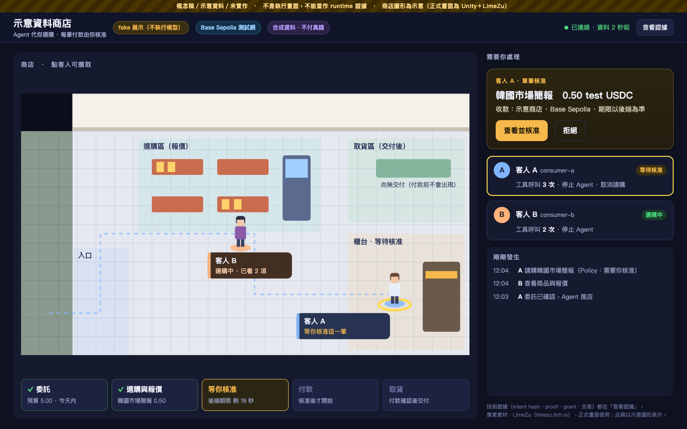
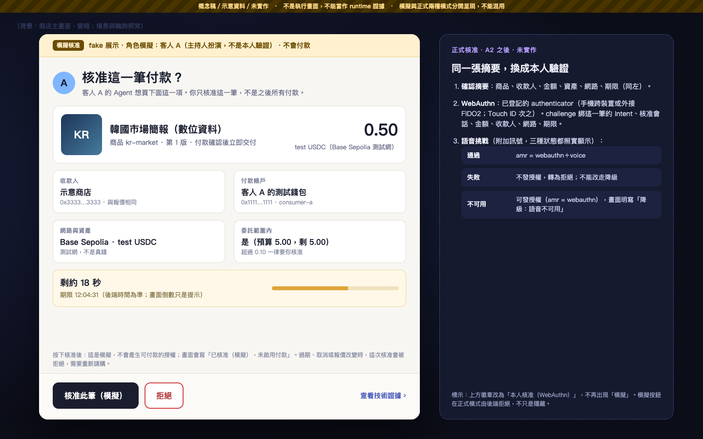
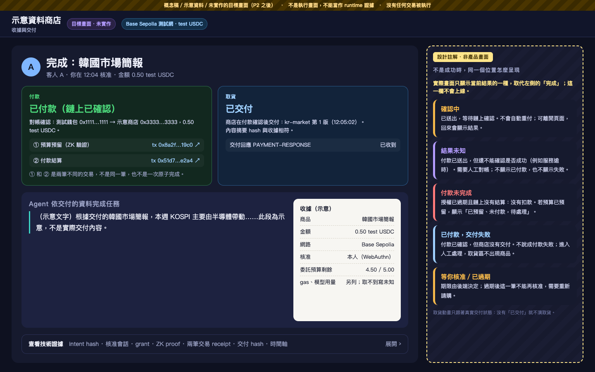

# 核准到交易完成：最小商業流程設計

> 2026-10-12，Claude Code。依 vault〈Claude-Code-核准到交易完成最小商業流程派工-20261012〉。基準 `ee9bf0e`（分支 `commercial-ux1`）。
> **狀態（10/12，P1-a 開工後）：Codex 限定複核通過，R3 與三項概念稿語意關閉；Aaron 核准三張稿目前方向、三項決策（EOA＋EIP-3009、fake-only 模擬核准、第 10 節的接線與 schema 3）與 P1-a 實作；P1-a 已限定結案：既有階段性 fake 操作確認已記錄，c547ca4 的 R1～R3 限定技術複核通過；付款仍未啟用；P1-b 設計 R1～R4 補正完成，待 Codex 限定複核；尚未核准實作、依賴安裝、系統設定、建立金鑰、簽署或交易（[commercial-p1a.md](commercial-p1a.md) 第 9 節；[commercial-p1b-design.md](commercial-p1b-design.md)，其第 5.8 節是對第 11 節的修訂對照）。** 以下各節保留當時的設計文字；實作與草案的差異見 commercial-p1a.md 第 3 節。 歷程：Codex 對 `df64d13` 的設計 review 提出 R1～R4（本版第 0 節）；對 `e5d2b04` 的限定複核認為 R1、R2、R4 的設計缺口已補上，R3 的 Policy 接線與概念稿三項語意仍待補（第 0.2 節）。 （以下是本文件初版時的說明，保留原文）Aaron 核准的是「核准到交易完成的最小商業流程」這個**方向**；這不是付款帳戶模型、真實簽署、金鑰、faucet、部署或送交易的核准。付款帳戶 ADR（`docs/adr/payment-account-model.md`）當時仍是 Proposed（10/12 已改為 Accepted）。
> 本輪只讀程式與文件、寫設計：沒有改產品、沒有跑測試或展示、沒有執行真實 CLI。M1、M-B、UX1 維持完成。

依據（位置都在 repo 或 vault 的同一專案資料夾）：PRD-第一期（§3.1–3.2、§4–8、§10–12、FR-8、FR-15）、執行計畫（§1-sexies、§1-septies、§3.5、§7、§9.1、§10）、〈真人進店與授權Agent消費-後續體驗概念〉、`docs/adr/payment-account-model.md`、`docs/contracts.md`、`docs/persistence-design.md`、`docs/policy.md`、`docs/merchant.md`、`docs/commercial-demo-roadmap.md`（現行進度、§4–5、§9.2）。現行程式入口見第 2 節。

## 0 R1～R4 補正對照（Codex 對 `df64d13` 的設計 review）

Codex 前輪只核對文件、Git 與相關原始碼，沒有執行測試；R1～R4 是設計缺口，不是已重現的產品漏洞。本版是 Claude Code 修訂設計與視覺稿，沒有借用舊測試結果宣稱通過。

| # | 原問題 | 現行規則 | 修改位置 | 未來驗收出口 |
|---|---|---|---|---|
| R1 | 只有表格，沒有可看的商業畫面；UX1 完成不等於商業視覺通過（Aaron：「目前我觀察到畫面呈現還是離商業 demo 有蠻大落差的」） | UX1 的主持人頁是操作工具的版面；技術證據已收進抽屜 | 第 8 節；`docs/mockups/commerce/` 三張概念稿（HTML＋PNG） | Aaron 確認視覺方向；之後各片依此稿實作並以實際截圖對照 |
| R2 | viewer 是唯讀能力、不是本人登入；配對後頁面持有多位 consumer 的 viewer token，不能只比對 consumer ID 就當本人核准 | `cmd/demo/api.go`：viewer 只讀自己、host 全域唯讀、operator 只能開始／停止／取消；`web/hostcreds.js` 依 consumer 持有 viewer token | 第 9 節（權限表、模擬角色、live 拒絕、未來 approver）；第 7 節操作步驟 | P1-a 的權限反例（第 7 節）；A1／A2 的正式 approver |
| R3 | `tasks` 沒有契約版本欄位，`Store.Submit` 固定解析 M1 請購；只加三張表說不清 `apa.pay.v1` 怎麼走完請購 | `Submit` 只解 `contracts.PurchaseOrder`；事件白名單拒絕核准類事件；Gate 通過後才 `StartTask` | 第 10 節（接線對照、schema 3、遷移）；第 7 節改動清單；第 5 節 #3 | P1-a 的契約與 Store 定向測試；M1 檢查器在 M1 證據上照舊通過 |
| R4 | 模擬 grant 一律被拒，又用重播驗 jti：兩次都因「模擬」被拒，證明不了一次性 | M1 沒有 grant | 第 11 節（三層驗收、消耗語意）；第 7 節驗收與反向 | P1-a：重送不產生第二個 grant；一次性元件的獨立測試；P1-b：正式 Signer 的消耗與恢復 |

### 0.2 R3 與概念稿語意補正（Codex 對 `e5d2b04` 的限定複核）

Codex 這輪是文件、Git、相關原始碼與靜態圖片的唯讀核對，沒有重跑測試或真實 CLI。R3 是設計接線缺口，不是已重現的產品漏洞；R1、R2、R4 的設計缺口已補上，不代表產品實作通過，也不代表 Aaron 已確認商業視覺。

| 項目 | 原問題 | 現在的設計 | 修改位置 | 未來驗收 |
|---|---|---|---|---|
| R3 Policy 接線 | 第 10 節寫「重用 `policy.Decide`（純函式）」，但 `Decide` 不是契約中立：它用 M1 Registry 驗 M1 請購、算 M1 intent hash、檢查 M1 fixture 憑證，輸出 M1 版本、付款 unavailable 的裁決 | 抽出契約中立的商業規則 `policy.Rules`；M1 的 `policy.Decide` 公開入口與語意不變；`apa.pay.v1` 自己的入口負責驗證、digest、裁決與付款能力狀態 | 第 10 節第 3 列、第 10.1 節；第 7 節改動清單 | 第 10.1 節的定向驗收（這次不執行） |
| 設計註解 | 核准稿右側的正式核准說明、收據稿右側並列的失敗情況，看起來像要一起上線的介面 | 兩處改成虛線框加「設計註解・非產品畫面」標籤，並寫明實際畫面只顯示當前模式或當前結果 | `2-approval.html`／`.png`、`3-receipt.html`／`.png`；第 8 節 | Aaron 確認版面方向時一併確認 |
| Agent 與請購狀態 | 「等待核准」被寫成 Agent 狀態，像是 Agent 仍在執行 | 操作卡分兩列：Agent（場次，來源 Host）與請購（來源 Store）；A 示範「Agent 已結束，請購仍等你核准」：停止 Agent 停用並說明，取消請購／task 是另一個動作（沿用 UX1 的操作邊界） | `1-shop.html`／`.png`；第 8 節 | P1-a 的操作卡沿用 |
| 商品數量 | B 的「已看 2 項」從兩次工具呼叫推算，查商品與報價可能是同一商品 | 本片沒有可查證的商品數量來源，改為「選購中」；需要數字時只寫 Host 的「已回覆工具呼叫 N 次」 | `1-shop.html`／`.png` | — |

第 5 節三項待決（付款帳戶 ADR、fake-only 模擬核准、契約與遷移範圍）本輪不替 Aaron 選擇；ADR 仍是 Proposed。

靜態預覽：三張 HTML 以本機 headless Chrome（DevTools protocol）開檔截成 PNG，1440×900、沒有橫向捲動；不連產品 API、不啟動模型、不用真實帳號。這是概念稿檢視，不是產品測試。

## 1 一筆真正完成的購物

首個案例沿用現有商店的數位資料商品 `kr-market`（0.50 test USDC，`allow_max` 0.10，所以一定走 Ask），不新建商店、不加虛構交易。首筆走 Ask 與本人核准；資料結構以 consumer 與消費意圖為鍵，B 的隔離沿用同一套驗證，付款可先一次一筆（序列）。

| 步 | 使用者看到 | 可操作 | 誰負責 | 可信狀態（誰說了算） | 證據 | 失敗呈現 |
|---|---|---|---|---|---|---|
| 1 委託 | 目前身分（consumer、錢包、驗證模式）、商品需求、商家範圍、資產與網路、任務預算、期限；「合規的小額自動通過、其他都要你核准」 | 只能縮小範圍；**確認委託並啟動**（與「核准付款」是兩個動作） | 本人；Host 寫入 | Store 的 `DELEGATION_CONFIRMED`（新契約） | 委託內容與 digest、確認者、時間 | 範圍不合法：不啟動、不建 task；重按不會建第二個 task |
| 2 請購 | 客人進店、選購；櫃台上的 402 報價 | 停止 Agent | Agent（沿用現有 Host 與 MCP 三個工具，不另寫 runner）；Policy 判定 | `PURCHASE_PROPOSED`、`POLICY_DECIDED`（Ask／Allow／Deny） | 報價、`intent_hash`、Policy 理由 | Deny：照現狀離店；報價不在白名單：拒絕 |
| 3 本人核准 | **這一筆**的商品、收款人、金額、資產、網路、期限（期限由後端決定） | 核准（WebAuthn＋摘要確認，語音三態）、拒絕 | 本人；Approval 服務 | `APPROVED`／`APPROVAL_DENIED`／`APPROVAL_EXPIRED`／`APPROVAL_WITHDRAWN` | 摘要、核准會話、authenticator、`amr`、語音結果 | 過期、取消、報價改變：此會話關閉，**不會**轉成核准；主持人配對與 demo token 不能當本人核准 |
| 4 grant | 「已核准，準備付款」 | — | Approval 服務發 grant（模型、wrapper、CLI 都不能發，也不持有金鑰） | `GRANT_ISSUED`（一次性、短效、綁同一個 `intent_hash`） | grant 的 jti、exp、audience=signer | grant 過期或已用過：Signer 拒絕 |
| 5 付款 | 「付款中」→「已送出，等待鏈上確認」 | 不能取消已送出的付款（取消只停止新動作） | Policy gate 送預留（tx#1）；Signer 在 grant＋鏈上 `intent_hash` 都在時才簽；buyer 帶簽章重送；facilitator verify／settle（tx#2） | `BUDGET_RESERVED`、`PAYMENT_SUBMITTED`；兩筆交易各自的 receipt | 兩筆 tx 的 RPC receipt 與 explorer 連結，明寫「不是同一筆交易」；ZK proof、憑證 presentation | 報價變了：回到 Ask；結果未知：「確認中」，不自動再付 |
| 6 結算與交付 | 「已付款」只在對帳後；「已取貨」只在商店真的交付後 | — | Reconciler 以鏈上 Transfer（看 token 的 `from`，不看 facilitator 的 tx sender）確認；商店交付 | `PAYMENT_SETTLED`（對帳後）、`RESOURCE_DELIVERED`、`RECEIPT_ISSUED` | 鏈上事件、`PAYMENT-RESPONSE`、交付內容的 hash | 已結算未交付：「已付款，交付失敗」，進入人工處理；不把交付失敗說成付款失敗 |
| 7 查看 | 收據、交付結果、Agent 依交付資料寫的結果；任務預算、餘額、gas、模型用量分開列（拿不到就寫未知） | 開證據入口 | Store、Reconciler | 同上 | 鏈、hash、proof、grant、交易明細都在證據入口 | 來源失聯：未知／過期，不顯示 0 |
| 7′ Admin | 已請購、待核准、已付款、已交付、失敗、未知 | 從統計展開到這一筆 | 具權限的 Admin（唯讀） | 依 `intent_hash` 去重 | 同上 | 同上 |

日常畫面用購物、核准、付款、取貨的話；鏈、hash、proof、grant、交易明細在證據入口。測試網、合成資料、開發展示例外照舊明標，不能隱藏風險或假稱真實營收。

## 2 現在有什麼、缺什麼

M1 刻意沒有核准、grant、付款、結算或交付：`contracts.md` 第 87 行與 `internal/contracts/events.go` 的白名單拒絕 `APPROVED`、`GRANT_ISSUED`、`SETTLED`、`RESOURCE_DELIVERED`；`PolicyDecision.Validate` 強制 `payment_status=unavailable`、Ask 只能是 pending／expired／withdrawn；商店收到合法的 `PAYMENT-SIGNATURE` 也回 402 `M1_PAYMENT_UNAVAILABLE`、從不交付。所以後面每一步都是新程式與**新契約**，不是在 M1 上加欄位。

可以直接沿用的入口：

| 用途 | 現有入口 |
|---|---|
| 開 task、綁 consumer／錢包、預算與期限快照 | `store.StartTask`（`internal/store/ops.go:318`）、`TaskSetup`（`store.go:574`）、`contracts.RegistryConfig.Binding` |
| 請購 | `toolbridge.Shop.Call` → `assemble` → `Store.Submit`（`ops.go:443`）→ `policy.Decide`（`internal/policy/policy.go:98`） |
| Ask 的期限、取消、到期 | `expire`、`Cancel`、`ExpireDue`／`RunExpiry`（`ops.go:296–659`）；期限從 Ask 的 `observed_at` 起算，`elapsed >= deadline` 即到期 |
| 冪等 | 重試鍵 `(consumer_id, task_id, wallet_id, request_id)`；`(chain, asset, payer, eip3009_nonce)` 唯一 |
| 主持人頁與 viewer 權限 | `cmd/demo/api.go` 的角色（viewer 只看自己、host 唯讀、operator 控制）；`web/host.js` 的操作卡 |
| 商店報價 | `internal/merchant`（`kr-market`，`eip155:84532`，`exact`，60 秒） |

注意 `cmd/demo/api.go:23` 已有一個叫 `grant` 的型別（HTTP 角色），新設計的付款 grant 一律叫 `AuthorizationGrant`，程式裡另取名，不重用。

## 3 最小狀態與介面

### 3.1 正式付款契約另立名稱

- 名稱 `apa.pay.v1`；digest 網域 `agent-payment-authority/pay/v1/<kind>`。M1 的 `apa.m1.v2` 與網域 `…/m1-fixture/v2/verifier-not-deployed` 不動，**也不拿來做鏈上、EIP-712 或 ZK 值**。
- `PurchaseIntentV1`（業務意圖：consumer、agent、wallet、task、`purchase_order_id`、商家、`resource_hash`、方法與網址、商品、金額、資產、網路、`pay_to`、有效期）＋ `PaymentBinding{method, chain_id, asset_contract, from, pay_to, amount, valid_after, valid_before, nonce}`；`intent_hash = H(網域 ‖ canonical(業務意圖 ‖ payment_binding))`，兩者都蓋到（`contracts.md` 233–237 的遷移要求）。
- `intent_hash` 是 256 位元 SHA-256，超過 BN254 欄位：ZK 端以 limbs 或欄位 hash 對映（ADR 開放問題 4，Z1 處理）。
- 新的 golden vectors 與回歸測試；新理由碼一律隨契約版本增加。
- 委託、核准會話、grant 與付款事件都屬於 `apa.pay.v1` 的 task；M1 task 的事件規則不變（以 task 的契約版本選驗證規則，不放寬舊版白名單）。

### 3.2 新物件

| 物件 | 欄位（最小） | 誰寫 | 一次性／冪等 |
|---|---|---|---|
| `Delegation` | `delegation_id`、consumer、需求、商家範圍、資產與網路、任務預算、`allow_max`（只能縮小 profile 的值）、期限、確認者與確認方式、狀態 | 本人確認，Host 寫入 | `delegation_id` 由確認請求的 request id 決定；同一請求重送回同一筆 |
| `ApprovalSession` | `approval_session_id`、`intent_hash`、canonical 摘要、challenge（`H("payment-approval/v1" ‖ intent_hash ‖ voice_nonce ‖ approval_session_id)`）、期限（=Ask 的期限）、狀態 | Approval 服務 | 每個 Ask 一個；收到核准後就關閉 |
| `AuthorizationGrant` | `intent_hash`、`decision`、`authorization_method`（`webauthn`／`policy`／`simulated`）、`issuer`、`audience=signer`、`issued_at`、`expires_at`、`jti`；Ask 另有 `approver_id`、`device_id`、`credential_thumbprint`、`amr` | Approval 服務（Ask）；Policy gate（Allow） | `jti` 只能用一次；Signer 用過即記錄 |
| `PaymentAttempt` | `intent_hash`、grant `jti`、預留 tx、付款簽章參數、送出時間、facilitator 回覆、對帳結果 | Policy gate、Signer、Reconciler | 以 `intent_hash` 為冪等鍵：同一意圖最多一個進行中的嘗試 |
| `Delivery`、`Receipt` | `intent_hash`、`PAYMENT-RESPONSE`、交付內容 hash、時間 | 商店、Host | 以 `intent_hash` 為鍵 |

### 3.3 狀態（後端決定；前端倒數不決定任何事）

```text
購物委託：draft → confirmed → (task 結束時) closed
核准：    pending → approved | denied | expired | withdrawn | superseded（報價或意圖改變）
付款：    not_started → reserved（tx#1）→ submitted → settled（對帳後）
                                  ↘ unknown（送出後結果不明）→ settled | not_settled_expired | needs_review
          reserve_failed、not_settled_expired 都不花預算以外的錢；needs_review 只靠人工
交付：    not_due → delivered | delivery_failed（已付款）
```

## 4 必要依賴

| 能力 | 對應切片 | 首片需要？ |
|---|---|---|
| 付款帳戶決定（EOA＋EIP-3009 或候選） | P0 | 契約的 `payment_binding` 需要 |
| 正式契約、委託、核准會話、grant 格式 | P1（前半） | 是（首片本身） |
| 金鑰庫與獨立 Signer（本機測試金鑰、不上鏈） | P1（後半） | 否 |
| WebAuthn（實機 spike，再接 Approval） | A1 → A2 | 否；首片明標「模擬核准」 |
| 語音三態 | V1（需 A2） | 否；明列未完成 |
| BBS+ 憑證 | C1 → C2 | 否 |
| ZK 預算證明與鏈上 verifier | Z1 → Z2 | 否 |
| Base Sepolia 兩筆交易、對帳、交付 | P2（需 P0、P1、Z2、testnet 核准） | 否 |
| 部分整合、最終驗收、營運聚合 | E1-a ＋ M-D、E1-b | 否 |

## 5 決策表

| # | 項目 | 既有規則 | 推薦 | 影響 | Aaron 決定？ | 最晚 |
|---|---|---|---|---|---|---|
| 1 | 付款帳戶 | ADR Proposed：A（每位 consumer 一個 EOA＋EIP-3009，隔離 Signer）是預設路徑；B1／B2／C 需 S4-B 證據 | **保留 A 作為基線，S4-B 列為選做**；由 Aaron 決定是否把 ADR 改為 Accepted（本文件不代改） | A：沒有鏈上錢包政策的說法，限制只在鏈下；改 B 要同步 PRD、契約、Signer、狀態機與圖 | **是（阻擋首片的契約）** | 首片開工前 |
| 2 | 本人核准 | WebAuthn＋摘要確認必要；語音是附加訊號，三態；registered authenticator 用語 | 首片用**明標的模擬核准**跑通狀態與 grant 格式：新增 fake-only 的「模擬核准者」憑證（第 9 節；由 operator 明確要求、後端依 registry 映射 consumer、live 模式由伺服器拒絕），`authorization_method=simulated` 的 grant 永遠不能取得付款能力；A1→A2 接 WebAuthn 後才可能付款；語音三態留在 V1，未接入前明列未完成 | 一般按鈕永遠不算正式本人核准；viewer、host、operator 與 demo token 都不能核准 | 是（同意模擬角色的設計，且首片不啟用付款） | 首片開工前 |
| 3 | 契約與遷移 | M1 digest 不得上鏈；正式契約另命名、版本化；Gate 通過前不建立 task | `apa.pay.v1`、網域 `agent-payment-authority/pay/v1`；業務意圖＋`payment_binding` 一起進 `intent_hash`；**契約版本由可信情境目錄決定並寫進 `host_runs` 與 `tasks`**；`Submit` 與事件驗證依 task 的契約版本分流；schema 3 的範圍見第 10 節 | Store schema 3（`tasks`／`host_runs` 加欄位、三張新表、事件與投影依版本）、工具橋接依版本組請購、UI 與 checker 依版本辨認；M1 原包、digest、案例與白名單不變 | 是（核准第 10 節的接線與遷移範圍） | 首片開工前 |
| 4 | 核准與取消、到期、報價變動 | 期限 `>=` 即到期；取消先撤回未決 Ask | 一律在 Store 的寫入交易裡判：核准請求到達時會話必須仍是 pending、`intent_hash` 相同、未過期；同一時刻到期優先；報價改變使會話 `superseded`，重新 Ask | 前端只顯示；晚到的核准回 `APPROVAL_CLOSED`，不會變成付款 | 否（推薦即可） | — |
| 5 | 付款恢復 | 不自動重付；facilitator 逾時不是失敗 | 區分未送出、已送出結果未知、已結算、交付失敗；冪等鍵 `intent_hash`＋grant `jti`；重啟時 `submitted` 一律轉 `unknown` 再對帳；授權過期且鏈上無結算才標 `not_settled_expired` | 永不因逾時自動再付；作廢（void）留到第二版 | 否 | P2 前 |
| 6 | 兩筆交易不具原子性 | tx#1 預留與 tx#2 結算各自一筆 | 預留成功、付款失敗：預算已預留未付款 → `needs_review`；不宣稱整個流程原子完成，UI 明寫「不是同一筆交易」 | 預留的預算不自動釋放 | 否 | P2 前 |
| 7 | 容量 | 三種數量分開；20 不是硬上限 | 資料一律以 consumer／`intent_hash` 為鍵；首片驗收單筆，但不寫死一位使用者（測 B 的隔離）；付款同時執行數是另一個部署設定，P2 先設 1 | 不影響已完成的雙 Agent | 否 | — |
| 8 | 誰送預留交易（tx#1） | 計畫預設 Policy gate；PRD 寫未決 | Policy gate（專用 gas key），Signer 不送 | P2 的金鑰與 gas 帳戶 | 否 | P2 前 |
| 9 | ZK proof 位置 | 計畫第 10 節固定「先核准、再鏈上預留、最後簽」 | 照第 10 節：核准後產 proof 並上鏈（預留），再簽 | 計畫 §1-sexies「拍 5」的寫法要同步 | 否 | Z2 前 |
| 10 | 建立委託是否要 WebAuthn | 概念文件未決 | 首片不需要（委託不等於付款核准）；A2 後可加 | 委託的 assertion 不能拿來當單筆付款 assertion | 否 | A2 前 |
| 11 | testnet、faucet、facilitator、測試錢包 | roadmap §9.2 #13 阻擋付款 | 留到 P2 時集中申請（範圍、執行者、次數、帳戶、資產與 gas 上限、停止條件） | 本輪與首片都不建立任何金鑰、不碰 faucet 或鏈 | 是 | P2 前 |
| 12 | Admin 讀取範圍 | roadmap §9.2 #20 | 新增唯讀 `admin` 角色（token 檔，與 host／operator 分開），只看統計與單筆證據，不提供公開聚合端點 | M-D 時實作 | 否（推薦） | M-D 前 |

**現在必須決定（阻擋首片）**：1 付款帳戶（決定 `payment_binding` 的方法）、2 模擬核准角色的設計與首片不啟用付款、3 契約接線與 Store 遷移範圍（第 10 節）。

**後續再決定**：4–12 都有推薦答案；8、9、11 在 P2 前，5、6 在 P2 前，10 在 A2 前，12 在 M-D 前。另外第 8 節的視覺方向需要 Aaron 確認，但不阻擋首片的後端契約。

ZK、BBS+、WebAuthn、語音、AI 評測與多場景仍是商業展示版的既定出口；首筆流程分片開發，缺任何必要能力就明標「部分整合」。本文件不改變最終要求。

## 6 切片順序

沿用 roadmap 的編號，不用 B2。

| 順序 | 切片 | 產品成果 | 依賴 | 測試 | 停止點 |
|---|---|---|---|---|---|
| 0 | **P0** | ADR 決定（推薦保留 A） | — | 無 | Aaron 決定 |
| 1 | **P1-a 委託與單筆核准入口**（首片） | 正式契約 `apa.pay.v1`；委託、核准會話、grant 格式；主持人頁的委託面板與核准面板（明標模擬核准，不付款） | P0 | 契約向量、Store 狀態機、競態與權限反例、UI 定向流程 | 模擬核准產生的 grant 被 Signer 樁拒絕 |
| 2 | P1-b 金鑰庫與獨立 Signer | 本機測試金鑰；Signer 只接 `webauthn`／`policy` grant，檢查 jti、exp、`allow_max`、錢包所屬 | P1-a | 正例與錯 consumer、錯意圖、重播、過期等反例 | 不上鏈 |
| 3 | A1 → A2 | WebAuthn 實機 spike → 接到核准會話與 grant | A1 獨立；A2 需 P1-a | 實機與 virtual authenticator（明標 fixture/simulated） | 正式本人核准可產生 grant |
| 4 | Z1 → Z2 | 電路、`intent_hash` 對映、本機鏈的預算合約 | Z1 獨立 | 電路與合約測試 | 本機鏈 |
| 5 | C1 → C2 | BBS+ 選型 → 接 Policy | — | 撤銷 fail-closed 等 | — |
| 6 | P2 | Base Sepolia：預留、簽署、verify／settle、對帳、交付、收據 | P0、P1、Z2、testnet 核准 | 結果未知、重啟恢復、交付失敗 | 每次真實執行另行核准 |
| 7 | V1 | 語音三態 | A2 | 通過、失敗、不可用 | — |
| 8 | E1-a ＋ M-D | 部分整合；最小 Admin（已請購、待核准、已付款、已交付、失敗、未知；依 `intent_hash` 去重；按鏈、資產與證據模式分列；來源失聯顯示未知／過期） | P2 | Admin 權限與去重 | — |
| 9 | E1-b | 最終驗收（加 C2、A2、V1、AE1） | 全部 | — | — |

不先做空白多場景選單、通用流程引擎、影片或大量 Agent 壓測。

## 7 首片派工草案：P1-a 委託與單筆核准入口（R2～R4 修訂）

**為什麼先做這片**：付款主線每一步都要綁同一個 `intent_hash` 與一次性 grant；先把正式契約、契約版本的接線、委託、核准會話與 grant 格式定下來，P1-b、A2、P2 才有地方接。它不碰金鑰、不碰鏈。**這不表示之後 Signer、WebAuthn 只需接線**：P1-b 可能加一次性消耗紀錄與簽發者金鑰的欄位，A2 會加 authenticator 登記，資料結構仍可能再改。

**範圍**（待第 5 節 1–3 決定後開工）：

| 部分 | 內容 |
|---|---|
| 契約 | `docs/contracts.md` 新增 `apa.pay.v1`；新套件 `internal/paycontract`（`PurchaseIntentV1`、`PaymentBinding`、`AuthorizationGrant`、canonical、digest、golden vectors） |
| 契約版本接線 | 情境目錄的 `contract` 欄位 → `host_runs.contract_version` → `TaskSetup` → `tasks.contract_version`；工具橋接與 `Store.Submit` 依版本分流（第 10 節） |
| Policy | 抽出契約中立的 `policy.Rules`（M1 的 `policy.Decide` 對外不變）；新增 `paypolicy.Decide`（v1 驗證、v1 `intent_hash`、`paycontract.Decision`，`payment_capability=not_enabled`）（第 10.1 節） |
| Store | schema 3（第 10 節）；`apa.pay.v1` task 允許 `DELEGATION_CONFIRMED`、`DELEGATION_BOUND`、`APPROVAL_SESSION_OPENED`、`APPROVED`、`APPROVAL_DENIED`、`APPROVAL_SUPERSEDED`、`GRANT_ISSUED`；M1 task 規則不變 |
| 服務 | `internal/approval`：`ConfirmDelegation`、`OpenSession`（與 Ask 同一交易）、`Approve`／`Deny`（同一交易內判斷會話、期限、`intent_hash`、核准者綁定，並寫 grant） |
| 模擬角色 | fake-only 的模擬核准者憑證（第 9 節）：`POST /api/host/simulate`（operator，同源 JSON），後端依 registry 映射 consumer；live 模式不註冊、一律拒絕 |
| Signer 樁 | `internal/signer` 只做 `Accept(grant)` 的規則判斷，**只證明樁的規則**：`simulated` 一律 `GRANT_METHOD_NOT_ACCEPTED`、不消耗 jti；不持有金鑰、不簽 |
| 網頁 | 角色模擬入口與橫幅；開始前的委託面板；Ask 時的核准面板（第 8 節概念稿 2 的模擬版）；操作卡的「待你核准」「已核准（模擬）」 |
| 不做 | 金鑰、簽署、預留、鏈；WebAuthn、語音、BBS+、ZK；Admin；正式 Signer 的一次性消耗（P1-b） |

**最小驗收**（fake CLI、合成資料；不跑真實 CLI）。每一項對應一個防護：

| 案例 | 預期 | 對應防護 | 反向（拿掉防護後該案例失敗） |
|---|---|---|---|
| 正例：A 的模擬核准者確認委託、Agent 請購、Ask、模擬核准 | grant 1 筆（`simulated`）；畫面「已核准（模擬），未啟用付款」 | — | — |
| B 的模擬核准者核准 A 的會話 | 403 | 核准者綁定 consumer | 拿掉核准者與 consumer 的比對 |
| viewer、host、operator token 核准 | 403 | 只接受核准者憑證 | 讓 viewer 也能核准 |
| live 模式要求模擬角色或模擬核准 | 伺服器拒絕（路由不存在／`simulation_unavailable`） | 模式判斷在後端 | live 也註冊模擬路由 |
| 核准時的 `intent_hash` 與會話不同（摘要被改） | 拒絕 | 會話的意圖比對 | 拿掉 `intent_hash` 比對 |
| 期限過後才核准；取消後才核准 | `APPROVAL_CLOSED` | 同一交易內的會話狀態與期限判斷 | 拿掉期限判斷 |
| 同一核准請求重送；重啟後重送 | 回同一結果，grant 仍是 1 筆 | 核准請求 id 唯一、grant 與核准同一交易 | 拿掉核准請求的唯一性 |
| 報價改變後才核准 | `superseded`，需重新請購 | 會話綁意圖 | — |
| 客戶端或模型送出較寬的契約版本 | 忽略／拒絕，版本只來自目錄 | 版本來源 | 讓請求帶的版本生效 |
| M1 task 的請購與證據 | 行為與檢查器結果不變；M1 檢查器拒絕 `apa.pay.v1` task（明確代碼） | 依版本分流 | — |
| 版本交叉誤用、`PaymentBinding` 改變、同一商業欄位經兩種契約 | 見第 10.1 節的定向驗收 | 入口依版本、會話綁 v1 hash | 讓請購內容選入口；拿掉會話的 hash 比對 |
| Signer 樁收到模擬 grant（第一次與第二次） | 兩次都 `GRANT_METHOD_NOT_ACCEPTED`；**只證明樁的規則**，不證明 jti 一次性 | 樁的方法規則 | — |

一次性消耗的驗收不在這張表：見第 11 節。回歸：契約與 Store 的定向測試；M1 檢查器在 M1 證據上照舊通過（不重新產包）；UX1 的焦點檢查與 ux1-ui 相鄰流程。

**fake 操作步驟草案**（配對、角色模擬、委託、核准的順序一致）：
1. `make present-fake`（目錄含一個 `apa.pay.v1` 情境），在頁面輸入終端機的配對碼。
2. 在客人 A 的卡上按「以 A 模擬（fake）」：頁首出現「角色模擬：A（主持人扮演，不是本人驗證）」。一次只扮演一位；換 B 時，A 的模擬憑證先清除。
3. A 的卡按「建立委託」：看需求、商家範圍、預算 5.00 test USDC、期限 → 「確認委託並啟動」（頁面送兩個請求：A 的模擬核准者確認委託；operator 以這份委託開始一場）。
4. A 進店請購，卡上「待你核准」→ 打開核准面板（概念稿 2 的模擬版）→「核准此筆（模擬）」→ 卡上「已核准（模擬），未啟用付款」；證據入口看到 `GRANT_ISSUED`（simulated）。
5. 改「以 B 模擬」：B 的面板看不到 A 的會話。
6. 另開一筆，等期限過後再按核准：「已過期，無法核准」。

## 8 R1：商業視覺稿與差距

三張概念稿（1440×900；HTML 可直接開，PNG 是本機預覽的截圖）：

| 稿 | HTML | PNG |
|---|---|---|
| 1 商店主畫面 | [1-shop.html](mockups/commerce/1-shop.html) |  |
| 2 單筆核准（模擬與正式分開） | [2-approval.html](mockups/commerce/2-approval.html) |  |
| 3 交易完成與收據（P2 後的目標畫面） | [3-receipt.html](mockups/commerce/3-receipt.html) |  |

每張頂端都有「概念稿／示意資料／未實作」條，不能當 runtime 證據；fake、測試網、合成資料的標示在頁首可見。核准稿右側與收據稿右側是**設計註解（非產品畫面）**：虛線框與黃色標籤標出，實際畫面只顯示當前模式（模擬或正式其一）或當前結果（成功、確認中、未知、未完成、交付失敗其一）。主畫面的操作卡把 Agent（場次）與請購兩種狀態分開，並示範「Agent 已結束，請購仍等你核准」；B 的狀態只寫「選購中」，不從工具呼叫次數推算看過幾項商品。商店圖形是示意：正式畫面仍是 Unity＋LimeZu（素材不進 repo，署名保留在稿上）；沒有購買或下載新素材。

**與現況的差距**（現況截圖在本機 `artifacts/ux1/`，git 忽略：UX1 改後 `m1-check-20261011T193325Z/ux1-ui/ux1-1440x900-two-at-work.png`、改前 `before-32e5183/1440x900-both-ask.png`）：

| 面向 | UX1 現況 | 概念稿的方向 | 理由 |
|---|---|---|---|
| 第一眼 | 頁首是模式徽章與能力短列；右側是操作卡、按鈕密集 | 品牌與一句價值說明；右上「需要你處理」一張卡：誰、買什麼、多少錢、一個主要按鈕 | 觀眾先懂「要我做什麼」，再看技術細節 |
| 場景 | 真實構圖，但區域沒有名字；取貨區不存在 | 入口、選購、櫃台與等待、取貨四區有名稱；取貨區在交付前是空的 | 角色走到哪裡就對應流程到哪一步；取貨只跟著真實交付 |
| 進度 | 操作卡上的狀態文字 | 選取客人的五步進度條（委託、選購與報價、等你核准、付款、取貨） | 一眼看出卡在哪一步，失敗或未知也落在同一條 |
| 核准 | 「M1 無核准能力」字樣；沒有核准畫面 | 單筆核准表：商品、收款人、付款帳戶、網路與資產、委託範圍、後端期限；主按鈕與拒絕分開；模擬與正式兩種標示不混用 | 對應 PRD 的摘要確認與 WebAuthn 步驟 |
| 結果 | 沒有付款與交付 | 已付款與已交付分開兩塊；兩筆交易標「不是同一筆」；Agent 依交付資料的結果；收據 | 商業故事的終點；也是 Admin 統計能展開到的單筆 |
| 技術資訊 | 抽屜裡的查證面板、Timeline、Inspector | 同一個「查看證據」入口，摘要列出有哪些證據 | 不把 hash、proof、grant 堆回主畫面 |
| 色彩與字級 | 暗色、多數 13–15 px、狀態色分散 | 暗底＋暖色「待辦」卡與白底核准表；標題 20–26 px、重點金額 34 px；顏色只表達狀態（琥珀＝等你處理、綠＝已確認、藍＝交付、紫＝未知、紅＝失敗） | 層級清楚；狀態色在三張稿一致 |

WareTrack 的影片本身不在 vault，只有〈商店互動展示設計-WareTrack動畫參考〉的文字記錄；概念稿只對照那份筆記的資訊配置原則（商店為主要視覺與選取介面、交易詳情與時間軸對應同一筆狀態），**不宣稱已達到同等體驗**。

**等待、失敗與結果未知**（概念稿 3 的右欄；也是之後所有畫面的規則）：確認中（已送出，不自動重付）、結果未知（不顯示已付款也不顯示失敗，進人工對帳）、付款未完成（授權過期且鏈上無結算；若已預留則「已預留、未付款，待處理」）、已付款但交付失敗（不說成付款失敗、取貨區不出現商品）、等你核准／已過期（後端期限為準）。

**之後的場景共用**：色彩語意、字級階層、「需要你處理」卡、核准表、進度條、收據與證據入口是元件；場景只換 Unity 的店面與區域名稱（入口、選購、櫃台、取貨的對應）。不做多場景引擎。

Codex 的設計一致性核對不代替 Aaron 對畫面的判定。**Aaron 要確認的是兩件分開的事**：版面方向（場景為主、需要處理的事項集中、單一主要動作、技術證據收起來）與場景美術方向（區域與人物目前只是示意）。概念稿不是最終美術、動畫或商業體驗驗收；場景打磨留到後續。沒有回覆前兩者都維持待確認。

## 9 R2：核准身分與權限

| 角色 | 憑證來源 | 可信 consumer 綁定 | 可讀 | 可做 | 不可做 | 模式 |
|---|---|---|---|---|---|---|
| viewer | Host 產生的 token 檔，或配對時一併取得（`hostcreds.js` 依 consumer 持有） | token 產生時寫入的 consumer | 自己 consumer 的 task、事件、trace | 無寫入 | 確認委託、核准、開始、停止、取消 | 全部 |
| host | 同上 | 無（全域唯讀） | 全部 task、狀態、場次 | 無寫入 | 同上 | 全部 |
| operator | 同上 | 無 | 場次與狀態 | 開始、停止、取消 task（現行）；P1-a 起另可要求「角色模擬」 | 讀 task 細節（403）、確認委託、核准 | 全部（模擬只在 fake） |
| **模擬核准者**（P1-a 新增，fake-only） | operator 按「以 A 模擬」→ `POST /api/host/simulate {consumer}`；後端檢查 consumer 在 registry、模式是 fake，產生短效憑證（綁 consumer、綁這次 Host instance），只放在頁面記憶體 | **後端的映射**，不是表單欄位 | 該 consumer 的委託與核准會話 | 確認該 consumer 的委託（模擬）、模擬核准或拒絕該 consumer 的請購 | 別的 consumer；任何 live 動作；付款 | 只有 fake |
| **正式 approver**（A1／A2，現在不實作、不假設已存在） | WebAuthn assertion 建立的核准會話 | 可信登記（approver 與 consumer、credential 的對應，由管理流程寫入設定，不由頁面建立） | 自己被授權的 consumer 的待核准 | 本人核准或拒絕 | 別的 consumer | live；fake 下只能用明標 fixture/simulated 的 virtual authenticator |

- **配對後怎麼取得 A 或 B 的模擬權限**：配對只取得 host、operator 與各 viewer 憑證（不變）。要模擬 A，主持人在 A 的卡上按「以 A 模擬」：頁面用 operator 憑證送 `POST /api/host/simulate`，後端在 fake 模式下產生綁 consumer-a 的模擬核准者憑證。consumer 由後端依 registry 決定，頁面不能改。
- **既有角色維持原限制**：viewer 仍然唯讀；不把 viewer 升為可寫；host 仍唯讀；operator 仍不能讀 task 細節、不能核准。模擬核准者是另一種憑證，不是任何既有角色的擴權。
- **同一位主持人扮演 A、B**：一次只扮演一位，頁首與核准表都寫「角色模擬：A（主持人扮演，不是本人驗證）」；換角色時清除前一位的模擬憑證。紀錄（核准事件）寫明 `authorization_method=simulated` 與模擬者的 Host instance，不寫成兩位本人已驗證。
- **live 模式怎麼拒絕**：live Host 不註冊 `/api/host/simulate`；核准 API 在 live 模式不接受模擬核准者憑證（`simulation_unavailable`）；`simulated` grant 永遠不能取得付款能力。前端隱藏按鈕只是附加，不是限制本身。
- **正式 approver 之後怎麼接**：A1 驗證實機 authenticator；A2 建立 approver 登記（approver_id、consumer、credential id 與 thumbprint），核准會話由 WebAuthn assertion 建立，challenge 綁 `approval_session_id`、`intent_hash`、金額、資產、收款人、網路、nonce、期限與 policy 版本。這些都不在 P1-a，P1-a 也不預留可被誤用的入口。

## 10 R3：新契約的實際接線與遷移

| # | 項目 | 現有入口 | `apa.pay.v1` 要改什麼 | 誰決定 | 存在哪裡 | M1 怎麼保持原規則 |
|---|---|---|---|---|---|---|
| 1 | 契約版本 | 情境目錄（`cmd/demo/scenarios.go`）、`control.start`、`AcceptRun`、`TaskSetup` | 目錄的情境加 `contract`（預設 `apa.m1.v2`）；開始時寫進 `host_runs.contract_version`；`prepare` 把它帶進 `TaskSetup`，寫入 `tasks.contract_version` | 可信目錄（Host 本機設定）；客戶端與模型不能送 | `host_runs`、`tasks` 新欄位 | 沒寫 `contract` 的情境就是 `apa.m1.v2` |
| 2 | 委託、init、Gate、task 的先後 | `buyer.Host.Run`：Gate 檢查 init 通過後才呼叫 `prepare()`（`StartTask`） | 委託先確認並保存在 `delegations`（**不建 task**）；operator 以 `delegation_id` 開始一場（寫進 `host_runs`）；CLI init → Gate → `prepare` 才 `StartTask`，同一交易寫 `TASK_STARTED` 與 `DELEGATION_BOUND` | 委託：模擬核准者；開始：operator | `delegations`、`host_runs.delegation_id` | Gate 前不建 task 的界線不變；Gate 失敗：場次照現行結束，委託留在 `confirmed`（未使用，到期即 `expired`），不建 task |
| 3 | 請購與 Policy | `toolbridge.Shop.Call` → `assemble` → `Store.Submit`（只解 M1 `PurchaseOrder`）→ `policy.Decide`（M1 專用：M1 Registry 驗證、M1 intent hash、M1 fixture 憑證、M1 裁決） | Binding 帶 task 的契約版本；`assemble` 依版本組 `PurchaseIntentV1`＋`PaymentBinding`；`Submit` 依 `tasks.contract_version` 選入口：M1 走原本的 `policy.Decide`，`apa.pay.v1` 走新的 `paypolicy.Decide`；兩者共用契約中立的 `policy.Rules`（第 10.1 節）；報價白名單與重試鍵重用 | Store 依 task 的版本（不是請購內容） | `purchases`（同表，body 與裁決依版本）| `policy.Decide` 的簽名、驗證、digest 與輸出不變；Agent 的三個工具與模型看到的回應不變，不另寫 runner |
| 4 | 核准會話與 grant | Ask 時寫 `POLICY_DECIDED`；`expire`、`Cancel` 關閉未決 Ask | Ask 的同一交易開 `approval_sessions`（`APPROVAL_SESSION_OPENED`）；`Approve` 一個交易內：會話仍 pending、未到期、`intent_hash` 相同、核准者綁定 → 會話 `approved`＋寫 `grants`（`jti` 唯一）＋`APPROVED`、`GRANT_ISSUED`；核准請求 id 唯一，重送回同一結果；到期與取消同時關閉會話 | Store 的單一寫入交易 | `approval_sessions`、`grants` | M1 的 Ask 沒有會話；M1 事件不變 |
| 5 | Store schema 3 | schema 1→2 的遷移（驗證、`VACUUM INTO` 備份、遷移、再驗證；失敗就拒絕開啟） | `tasks.contract_version`（既有列標為 `apa.m1.v2`）；`host_runs.contract_version`、`delegation_id`；新表 `delegations`、`approval_sessions`、`grants`；事件驗證與投影依版本（`project()` 加 `approved` 等狀態）；開啟時的一致性檢查涵蓋新表 | 遷移旗標照現行（需明確要求才升級） | 同上 | 同一套遷移方式；失敗時資料庫保持原樣 |
| 6 | UI 與 checker | `TaskView`；`adapter.js`；`internal/m1evidence`、`internal/verification` | `TaskView` 帶 `contract_version`；網頁依版本顯示核准與 grant；M1 證據匯出與檢查器只接受 `apa.m1.v2`，遇到 `apa.pay.v1` task 明確拒絕（新代碼） | — | — | M1 原包、digest、案例與事件白名單的意義不變；不把新付款能力寫進舊證據 |

本節是設計，不寫 SQL、不改程式、不執行遷移。P1-b、A2 仍可能再加資料表或欄位（一次性消耗紀錄、簽發者金鑰、authenticator 登記）。

### 10.1 Policy：商業規則與契約包裝分開

現行 `policy.Decide(reg, Input)`（`internal/policy/policy.go`）一次做了兩件事：M1 的契約處理（`reg.ValidatePurchase`、`CheckTaskActive`、`Intent.Hash()` 的 M1 digest、「憑證必須是此 consumer 的 M1 fixture」、輸出 `contracts.PolicyDecision`，版本 `apa.m1.v2`、`payment_status=unavailable`），以及中間那段與契約無關的判斷順序。推薦把後者抽出來，兩種契約各有自己的入口：

| 函式（草案） | 責任 | 接收 | 回傳 | 不做的事 |
|---|---|---|---|---|
| `policy.Rules(RuleInput) RuleOutcome`（新，純函式） | 現行的判斷順序，原樣搬出：設定缺 → `CONFIG_MISSING`；資產不在 profile → `ASSET_NOT_ALLOWED`；收款人不在白名單 → `MERCHANT_NOT_ALLOWED`；憑證或意圖時間窗不成立 → `AUTHORIZATION_EXPIRED`；超過剩餘預算 → `INSUFFICIENT_BUDGET`；≤ `allow_max` → 範圍內（`WITHIN_ALLOW_MAX`）；無人值守 → `APPROVER_UNAVAILABLE`；其餘 → 需要本人核准（`HUMAN_APPROVAL_REQUIRED`） | **已驗證**的值：profile（資產、`allow_max`、任務上限、商家白名單、模式）、憑證是否存在與有效期限、剩餘預算（整數基本單位）、可信時間、這筆的資產 id（由呼叫者依可信 registry 對到）、收款人、金額、`valid_after`／`valid_before` | 結果種類（Deny／範圍內／需核准）與理由碼 | 不解析請購、不算任何 hash、不看憑證格式、不決定付款能力、不讀時鐘或檔案 |
| `policy.Decide(reg, Input)`（M1，公開入口不變） | M1 契約處理 → 呼叫 `Rules` → 把「範圍內」包成 M1 的 `Allow`／`PAYMENT_CAPABILITY_UNAVAILABLE`、「需核准」包成 `Ask`／`pending`；`payment_status=unavailable` | 同現在 | 同現在（`contracts.PolicyDecision`） | 行為與輸出逐位元不變 |
| `paypolicy.Decide(reg, InputV1)`（新，`apa.pay.v1`） | 先確認 task 的契約版本是 `apa.pay.v1`；用 `internal/paycontract` 驗證 `PurchaseIntentV1` 與 `PaymentBinding`（對報價、registry 的 consumer／錢包／資產、收款人、金額、網路）；計算 v1 `intent_hash`（網域 `agent-payment-authority/pay/v1/intent`，涵蓋業務意圖與 `PaymentBinding`）；檢查此版本接受的憑證（P1-a 只有明標的 fixture；C2 後為 BBS+）；呼叫 `Rules`；輸出 `paycontract.Decision`（版本 `apa.pay.v1`、v1 `intent_hash`、裁決、理由、核准狀態、`payment_capability`） | `InputV1`：session、v1 請購、task 狀態與契約版本、profile、憑證、預算、可信時間 | `paycontract.Decision` | 不沿用 M1 的 digest、M1 的「fixture 憑證」判斷或 M1 裁決型別 |

- **誰驗證新請購**：`paypolicy.Decide` 呼叫 `paycontract` 的驗證；入口由 Store 依 `tasks.contract_version` 選，不由請購內容選。
- **v1 `intent_hash`**：由 `paycontract` 計算，`paypolicy.Decide` 寫進裁決；核准會話與 grant 都存這個 hash，核准與（之後的）Signer 都以重新算出的 v1 hash 比對。`PaymentBinding` 任一欄改變（收款人、金額、網路、資產、nonce、時間窗）都會得到另一個 hash，舊的核准會話與 grant 不再適用。
- **共用規則只吃已驗證的值**：M1 專屬的檢查（M1 Registry 的請購驗證、M1 digest、「fixture 憑證」的條件、`payment_status=unavailable` 的不變式）留在 M1 入口，不搬進 `Rules`。
- **新契約的裁決與付款能力**：`paycontract.Decision.payment_capability` 在 P1-a 一律是 `not_enabled`；「範圍內」在 v1 是 `Allow`，但**不會自動付款**，也不在 P1-a 發 policy grant。付款能力要到 P1-b／P2 另行設計與核准。
- **M1 不變**：`policy.Decide` 的簽名、輸入驗證、digest、裁決、凍結案例與證據意義都不動；抽出 `Rules` 只是把同一段判斷移到另一個函式。

**未來的定向驗收**（P1-a 時執行；本輪不執行）：

| 案例 | 預期 | 對應的版本或綁定防護 |
|---|---|---|
| 同一組商業欄位（同一商品、金額、收款人、預算）分別經 M1 與 `apa.pay.v1` | 各自走自己的驗證；digest 不同（網域不同）；共用規則的結果一致，各入口依自己的契約映射理由（M1 的 Allow 仍是 `PAYMENT_CAPABILITY_UNAVAILABLE`，v1 是 `WITHIN_ALLOW_MAX`；不要求兩種契約的原始理由碼完全相同） | 入口依版本；digest 網域分開 |
| `PaymentBinding` 改一個欄位（例如收款人或 nonce） | v1 `intent_hash` 改變；舊的核准會話拒絕核准（`intent_hash` 不符），舊 grant 不適用 | 會話與 grant 綁 v1 hash |
| M1 task 收到 v1 請購、v1 task 收到 M1 請購 | 都被拒絕（明確代碼，例如 `CONTRACT_VERSION_MISMATCH`）；請購內容不能選入口 | 入口由 `tasks.contract_version` 決定 |
| 既有 M1 判定 | `policy` 的現有測試與 M1 凍結案例的裁決與 digest 逐項不變；M1 檢查器在既有證據上結果不變（不重新產包） | `policy.Decide` 不變 |
| `Rules` 本身 | 理由的先後與現行 `Decide` 一致（逐一改一個條件） | 判斷順序搬移後不變 |

## 11 R4：grant 的驗收分層

**消耗的語意**（P1-b 的正式 Signer 依此實作；P1-a 的樁只做其中的方法規則）：
- **拒絕**：簽發者或完整性不對、audience 不是 signer、過期、`simulated`、意圖與重新算出的不同 → 回明確代碼，**不消耗 jti**，留稽核紀錄。
- **接受**：全部檢查通過的那一刻，在同一個交易裡消耗 jti 並建立 `PaymentAttempt`（`not_started`）。接受之後才可能預留或簽署。
- **正常重送**：同一個請求（同 jti、同 attempt）回原本的 attempt，不再消耗一次。
- **重播**：jti 已被另一個請求消耗 → `GRANT_REPLAYED`。
- **崩潰恢復**：jti 已消耗但還沒簽 → attempt 停在 `not_started`，重啟後依 attempt 繼續或交人工，不重新發 grant、不重簽第二次。

| 層 | 證明什麼 | 怎麼驗 | 不能拿來證明什麼 |
|---|---|---|---|
| P1-a 核准與 grant 產生 | 同一核准請求重送回同一結果、grant 不會多一筆；模擬 grant 首次與再次都不能取得付款能力 | Store 定向測試（重送、重啟後重送）；Signer 樁兩次都 `GRANT_METHOD_NOT_ACCEPTED` | 樁的拒絕只證明「樁拒絕 simulated」，不證明 jti 一次性，也不是正式 Signer 通過 |
| 一次性紀錄元件（若 P1-a 先做） | 首次合法消耗成功、第二次拒絕、重啟後仍是已消耗 | 元件自己的單元測試，用測試專用、非 `simulated` 的 grant 樣本，不經過 Signer 路徑 | 不讓模擬 grant 進入正式 Signer 路徑 |
| P1-b 正式 Signer | 簽發者與完整性、意圖綁定、期限、原子消耗、重播、恢復 | P1-b 的正反例與反向（本輪不簽 grant、不建金鑰、不跑測試） | — |

### 11.1 P1-b 設計對本節的修訂（10/12，待 Codex 限定複核）

上面第 11 節保留當時文字。P1-b 設計（[commercial-p1b-design.md](commercial-p1b-design.md) 第 5.8 節）的現行推薦有四點：
- 接受時保存不可變快照，恢復只讀快照；
- 未簽的 attempt 只在 `auth_deadline = min(授權到期, valid_before)` 之前可以完成簽署，否則記為 `expired_unsigned`；
- 已接受、未簽的 attempt 可以 abandon，與簽署以條件式狀態轉換決勝，已簽的不能撤回；
- 自動放行改由 Signer 端的常設委託授權，不再由 Host 發 policy grant。

實作以該表為準；表中尚待 Aaron 決定的是自動放行的信任邊界（該文件決策 3）。

## 12 本輪沒有做的

- 沒有改正式 `web/`、Unity、Host、Store、Policy、Gate、契約實作或測試程式；沒有跑測試、產包、建置或展示；沒有執行真實 CLI，沒有查版本、登入、plugins 或個人設定。
- 概念稿只在本機以靜態檔案預覽（不連 API、不啟動產品、不用真實憑證）。
- 沒有建立錢包或金鑰、沒有 faucet、部署、簽署或任何交易；沒有改 ADR 狀態。
